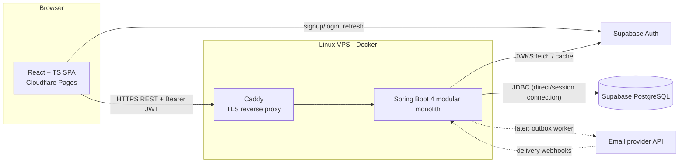
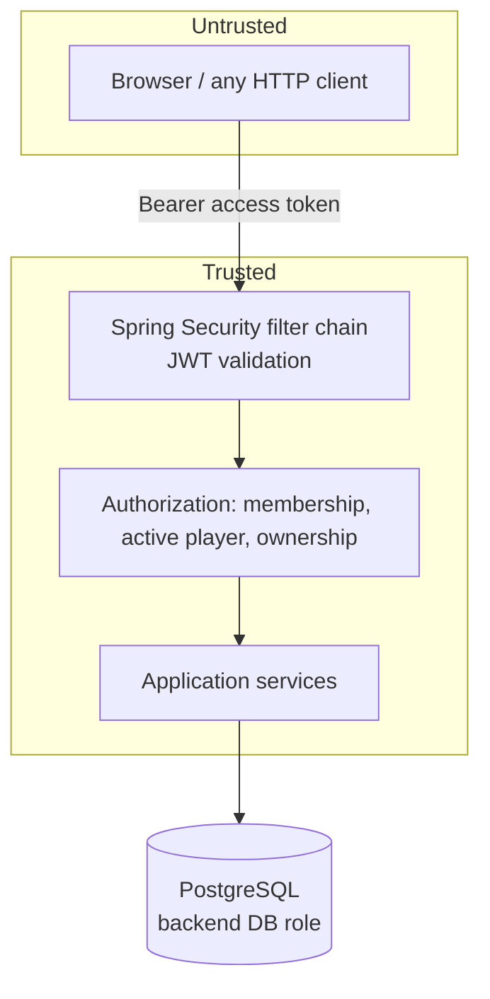

# Architecture

## 1. Shape of the system



- **One backend deployable.** A single Spring Boot application, one process, one
  database. Horizontal scaling is possible later (stateless API + DB locks) but
  not required.
- **Supabase is used for two things only:** Auth (identity, sessions, token
  issuance) and hosting PostgreSQL. No Supabase client writes; no PostgREST access
  to game data.
- **The frontend is static** and talks only to Supabase Auth and our REST API.

## 2. Backend layering

Each module follows the same internal layout:

```
<module>/
  api/            Public interfaces + DTO records other modules may use
  web/            @RestController, request/response DTOs, mappers   (thin)
  application/    @Service use cases, @Transactional boundaries, orchestration
  rules/          Pure Java rules engine: records in → records out (no Spring/JPA)
  domain/         JPA entities with invariant-guarding methods, repositories
  infra/          Adapters: external HTTP clients, schedulers, config
```

Dependency direction: `web → application → (rules, domain) ; infra → application`.
`rules` depends on nothing but the JDK and the `shared` kernel.

**Pragmatic hybrid model.** JPA entities are the persistent aggregates and guard
simple invariants (`city.removePopulation(n)` checks `n ≤ population`). The
**rules engine** holds all game math (employment, income, combat, siege,
movement legality) as pure functions over immutable snapshots. Application
services: load entities → build snapshot records → call rules → apply the result
to entities. This keeps the hard logic trivially unit-testable and deterministic,
without a full separate domain model mirrored onto JPA.

## 3. Modules

| Module | Responsibility | Owns tables | Phase |
|---|---|---|---|
| `platform` | Technical foundation, no game logic: security policy, RFC 9457 error handling (`ApiException`, `ApiExceptionHandler`), request-id correlation, health endpoint | — | 1 |
| `shared` | Domain value types (`Gold`, `Population`, ids), apportionment utils | — | 4 |
| `identity` | JWT → `Principal`, player provisioning, profile | `player` | 2 |
| `world` | Map templates (topology + SVG geometry, read-only, validated at startup by `MapValidator`); per-game world instantiation and state (nations, province owner/controller, cities) until economy and military take over their columns | `map_template`, `province_template`, `province_adjacency`, `nation_template`, `nation_start_province`, `nation`, `province_state`, `city` | 3 |
| `game` | Game lifecycle: lobby (create, join by code, nation choice), start, sequential turns, **command pipeline**, `RoundProcessor` (round-end extension point), later ruleset snapshot and history. Absorbed the Phase 2 `lobby` package in Phase 3 | `game`, `game_player`, `game_command`, `round_resolution` (later `game_event`, `game_incident`) | 2–3 |
| `economy` | **Implemented (Phase 4).** Pure rules (`economy.rules`: employment, collectible income — zero for occupied cities, Q-W2 —, settlement, construction checks), ruleset files per version, treasury, workshops and construction projects, round-end phases `ECONOMY` and `CONSTRUCTION`, start-up economy, queries. Later: repairs, upgrades, growth | `nation_economy`, `building`, `economy_round_report` | 4 |
| `military` | **Implemented (Phase 5).** Pure rules (`military.rules`: `Battle`, `Recruitment`, `Movement`, `Upkeep`, `Retreat`, `Occupation`), ruleset files per version, battalions, armies, recruitment / move-and-battle / regroup commands, battle reports, starting forces, upkeep source for the economy, round step `SIEGES` (simple occupation). Phase 6 adds reinforcement, disbanding and origin cohorts (`Reinforcement`, `Disbanding`, `Cohorts`, `BattalionService`, `battalion_cohort`, `manpower_transfer`). Battle resolution lives here rather than in a separate `combat` module — it is one pure class, and splitting it would only add an API hop | `army`, `battalion`, `battalion_cohort`, `battle_report`, `manpower_transfer` | 5–6 |
| `siege` | **Implemented (Phase 7).** Pure rules (`siege.rules`: `SiegeMath` — required progress, progress per round, attrition, bombardment targets, repair price and timing; `ControlDecision` — the single occupation/siege policy; `FortressWorks` — build/upgrade/repair checks), ruleset files `rulesets/<version>/siege.json`, fortifications, sieges and their round history, round steps `SIEGES` (replacing the Phase 5 occupation phase) and `FORTIFICATIONS`, fortress upkeep, starting fortresses, queries and fortress commands. Implements `military.api.SiegeGate` and `economy.api.SiegeStatus`; reads `military.api.MilitaryPresence`, `economy.api.WorkshopsApi`, `world.api` | `fortification`, `siege`, `siege_round` | 7 |
| `research` | **Implemented (Phase 8)** (planned as `technology`). Pure rules (`research.rules`: `ResearchRules` — validated, declarative ruleset; `Research` — points, unlock quotes, effects, institution checks), ruleset files `rulesets/<version>/research.json`, institutions, national research and doctrines, round steps `RESEARCH` and `INSTITUTIONS`, institution upkeep, research rows for new games, queries and commands. Implements `military.api.MilitaryModifiers` and `economy.api.EconomyTechnology` | `institution`, `nation_research`, `nation_doctrine`, `research_round_report`, `research_unlock` | 8 |
| `diplomacy` | **Implemented (Phase 9).** Pure rules (`diplomacy.rules`: `DiplomacyRules` — validated ruleset; `Diplomacy` — standings, war and alliance blockers, defensive response, termination; `WarScore`; `PeaceTerms` — term validation, settlement order, tribute arithmetic; `Victory` — round-limit standings), ruleset files `rulesets/<version>/diplomacy.json`, war/alliance/peace commands with atomic settlement, round steps `TRIBUTE` and `DIPLOMACY`, diplomacy rows for new games, queries. Implements `military.api.Hostility`, `military.api.WarEvents` and `game.api.VictoryCondition`; uses `military.api.ForceWithdrawal`, `economy.api.EconomyApi` (`transfer`, `grossIncome`), `world.api.WorldApi` (`transferOwnership`, `setController`, `changePopulation`) and `game.api` | `diplomacy_game`, `alliance`, `war`, `war_participant`, `war_front`, `war_score_event`, `peace_proposal`, `peace_treaty`, `truce`, `tribute`, `tribute_payment`, `diplomacy_event` (the game module owns `game_result`, `game_result_standing`) | 9 |
| `analytics` | Activity aggregation, player statistics | `player_activity_daily`, `player_game_result` | 10 |
| `communication` | Email preferences, outbox, provider integration, unsubscribe | `communication_preference`, `email_message`, `email_campaign`, `email_delivery_event` | 10 |

Rules for cross-module interaction:

- Modules call each other only through `api` packages (interfaces implemented in
  `application`). No module reads another module's repositories or entities.
- **The game module orchestrates**; feature modules run their commands through it and
  contribute `RoundPhase` beans whose order the game module fixes.
- **Extension points in `game.api` (implemented):** `RoundPhase` (with the `Step` enum that fixes the
  round-end order), `GameCommands` (the command pipeline for other modules), `GameAccess`
  (membership for queries) and `GameStartInitializer`. Feature modules depend on `game.api`; the
  game module never depends on them.
- **Phase 9 extension points (no cycles, enforced by `ModuleBoundariesTest.moduleDependenciesHaveNoCycles`):**
  `military.api.Hostility` (who is at war, who may enter whose territory — read by movement, battles,
  retreat and the siege engine's control decision; without an implementation, and for rulesets
  before v5, `Relations.TOTAL_WAR`), `military.api.WarEvents` (battles and successful sieges
  reported once for war score) and `game.api.VictoryCondition` (asked once per round end; the game
  module stores the result and finishes the game) are implemented by the diplomacy module;
  `military.api.ForceWithdrawal` is implemented by military for it. Dependency direction:
  `diplomacy → military.api, economy.api, world.api, game.api`; no module depends on diplomacy.
- **Phase 8 extension points:** `military.api.MilitaryModifiers` (technology and doctrine effects read
  by the battle engine input, the siege engine and battalion upkeep) and `economy.api.EconomyTechnology`
  (highest workshop tier, growth bonus) are implemented by the research module, which depends on
  `economy.api`, `military.api`, `world.api` and `game.api` only. Effects are typed numbers from the
  ruleset applied by Java code; nothing in a ruleset is executed. Population growth is an economy
  round phase.
- **Phase 7 extension points (SPI pattern, no cycles):** `military.api.SiegeGate` (military asks
  whether a province is besieged and reports moved battalions) and `economy.api.SiegeStatus` (economy
  asks whether a city is besieged) are implemented by the siege module; `military.api.MilitaryPresence`
  and `economy.api.WorkshopsApi` are implemented by military and economy for it. Dependency direction:
  `siege → military.api, economy.api, world.api, game.api`; neither military nor economy depends on siege.
- **Other extension points (Phase 5):** `economy.api.EconomyApi` (treasury read and spend inside a
  command) and `economy.api.UpkeepSource` (implemented by military, so the economy never depends
  on it); `world.api.WorldApi` adds `topology`, `changePopulation` and `setController` (control
  only, never ownership). Dependency direction: `military → economy.api, world.api, game.api`.
- Per-game mutations are only allowed inside the command pipeline transaction or
  round processing, or the game-start transaction (enforced by convention and review; the
  source-based `ModuleBoundariesTest` checks cross-module access).
- `analytics` and `communication` never write game tables and never run inside
  game transactions. They read committed data (`game_command`, `game_event`,
  results) asynchronously.
- Boundaries are verified in CI with **Spring Modulith** `ApplicationModules.verify()`
  (if compatible with the Boot 4 baseline at Phase 1) or **ArchUnit** rules.

### 3.1 Command handling sketch

```java
sealed interface GameCommand permits EndTurn, Recruit, MoveBattalions, RegroupBattalions, BuildWorkshop, ... {}

interface CommandHandler<C extends GameCommand> {
    Class<C> type();
    CommandResult handle(C command, CommandContext ctx); // ctx: locked game, actor, ruleset, clock
}
```

`GameCommandService` owns the transaction, lock, membership/active-player checks,
idempotency and recording; handlers own validation and application. Controllers
translate resource-oriented REST calls into `GameCommand` records.

## 4. Security boundaries



### 4.1 Authentication (implemented in Phase 2)

```mermaid
sequenceDiagram
    participant B as Browser (React)
    participant S as Supabase Auth
    participant A as Spring API
    B->>S: signUp / signInWithPassword (supabase-js)
    S-->>B: session (access token, refresh token) — persisted, auto-refreshed
    B->>A: GET /api/v1/me  Authorization: Bearer <access token>
    A->>S: GET /auth/v1/.well-known/jwks.json (cached; refetched on unknown kid)
    A->>A: verify signature + claims, resolve/provision player by sub
    A-->>B: 200 profile
```

- Supabase Auth owns registration, login, password storage and sessions. The backend stores
  no passwords and holds **no Supabase secret**: verification only needs the public JWKS.
- Spring Security runs as an OAuth2 **resource server** with one `JwtDecoder`
  (`platform.security.SupabaseJwtDecoders`), configured from `SUPABASE_URL`:
  - signature against `<url>/auth/v1/.well-known/jwks.json`;
  - accepted algorithms: **asymmetric only**, `ES256`/`RS256` (`SUPABASE_JWT_ALGORITHMS`).
    HS256 / legacy shared-secret tokens and `alg: none` are rejected — projects must use
    Supabase JWT Signing Keys;
  - `iss = <url>/auth/v1`, `exp` required and not passed, `nbf` honoured (60 s skew),
    `aud` contains `authenticated`, `role = authenticated` (rejects `anon`, `service_role`),
    `sub` is a canonical UUID, `is_anonymous` is not true.
- Identity: the verified `sub` → `player.supabase_user_id` (unique). A `CurrentPlayer`
  controller parameter (resolved by `identity.web.CurrentPlayerArgumentResolver`) gives
  controllers the acting player; the first call provisions the row race-free. Request
  bodies never carry player ids. The sign-up display name arrives in
  `user_metadata.display_name`; it is user-controlled, so it is validated and only used as a
  suggestion. Email is not stored (BACKGROUND_JOBS data minimisation).
- Failures: 401 problem JSON (`UNAUTHENTICATED`) with `WWW-Authenticate: Bearer`.
- Default deny: only `GET /api/v1/health` and `/actuator/health/**` are public; no form
  login, HTTP Basic or local users; only the `health` actuator endpoint is exposed.
- Stateless: no server sessions, CSRF disabled for the bearer-token API. CORS allows only
  `CORS_ALLOWED_ORIGINS` (local default: the Vite dev server), methods
  GET/POST/PUT/PATCH/DELETE, headers `Authorization`, `Content-Type`, `Idempotency-Key`,
  `If-None-Match`, `X-Request-Id`; credentials (cookies) are never allowed.
- Tests sign real ES256 tokens with an in-process JWKS server (`support.TestJwtIssuer`), so
  the production decoder is exercised end to end; nothing in the chain is mocked.

### 4.2 Authorization (every request)

| Check | Where | Failure |
|---|---|---|
| Authenticated, valid token | Filter chain | 401 |
| Player provisioned | `CurrentPlayerArgumentResolver` (provisions on first use) | — |
| Member of the game | Command pipeline / query service | **404** (do not leak game existence for private games) |
| Active player (gameplay commands) | Command pipeline | 409 `NOT_ACTIVE_PLAYER` |
| Resource belongs to the player's nation (army, city, battalion) | Command handler, via `(game_id, nation_id)` filter | 404 `RESOURCE_NOT_FOUND` or 403 `NOT_OWNER` |
| Host-only lobby actions | Lobby service | 403 `NOT_HOST` |
| Operator endpoints | Separate role claim / allowlist, separate path prefix `/admin` | 403 |

- **Client-supplied player ids are never trusted.** The acting player is always
  derived from the token. Request bodies never contain "who I am".
- Resource lookups are always scoped: `findByGameIdAndIdAndNationId(...)`, never
  `findById(...)` followed by a check that might be forgotten.

### 4.3 Database security

- Game tables live in a dedicated schema (`game`) **not exposed** through Supabase's
  Data API, and Row Level Security is enabled on every table with **no policies**
  for `anon`/`authenticated` roles (deny-all defence in depth).
- The backend connects with a dedicated least-privilege Postgres role
  (`strategy_app`: DML on `game` schema). Flyway runs migrations with a separate
  migration role/credential in CI/CD.
- Supabase `service_role` key is not used by the backend at all and never reaches
  the frontend. The frontend only has the publishable anon key, which is useless
  against the non-exposed schema.
- Connection: direct connection or session-mode pooler. **Not** the
  transaction-mode pooler: it breaks prepared statements and session settings
  (`SET LOCAL` still works but surprises accumulate). HikariCP pool sized small
  (e.g. 10).

### 4.4 Other hardening (Phase 15, fundamentals in every phase)

Rate limiting per user on command endpoints (Bucket4j in-process — no Redis
needed for one instance), request size limits, strict JSON (fail on unknown
properties for commands), security headers via Caddy, dependency scanning
(Dependabot), container runs as non-root, secrets via environment only.

## 5. Frontend architecture

| Concern | Choice |
|---|---|
| Build | Vite, TypeScript strict |
| Routing | React Router |
| Server state | TanStack Query (polling with ETag for game summary) |
| Auth | `@supabase/supabase-js` **auth only**; access token attached to API calls |
| API types | Target: generated from backend OpenAPI (`openapi-typescript`). Phase 2 uses hand-written types in `src/api/types.ts` until an OpenAPI document is published |
| Map | SVG: one `<path>` per province from template geometry (cached by `map_template.version`); overlay layers for owner colours, armies, sieges, selection |
| Styling | CSS modules or Tailwind (decide in Phase 2; no component framework lock-in required) |
| Tests | Vitest + React Testing Library; Playwright E2E from Phase 5 |

Screens are added per phase (see [ROADMAP.md](ROADMAP.md)). The client never
computes authoritative results; it may *preview* (e.g. show projected income)
using values returned by the API, not by re-implementing rules.

Map geometry: authored as SVG in a map editor tool (e.g. Inkscape/Figma), with
each province path tagged by its `province_key`. A build-time script (Phase 3)
converts the SVG + a YAML/JSON province sheet into a Flyway-loadable seed or a
JSON resource the backend imports into `map_template` tables. Adjacency is
authored explicitly (not computed from geometry) to allow straits and to keep
river edges intentional; a validation test checks symmetry and connectivity.

## 6. Configuration and rulesets

- `application.yml` per profile (`local`, `test`, `prod`); secrets via env vars.
- **Ruleset**: versioned JSON resources per module (`rulesets/<version>/economy.json`,
  `rulesets/<version>/military.json`) containing every balance number (unit stats, costs,
  upkeep, combat coefficients, later siege constants…). Parsed into typed records at startup and
  validated in their constructors. A game stores its `ruleset_version` at creation and keeps it
  (new games use `strategy.ruleset.current-version`, currently `v2`); balance changes add a new
  version, never edit an existing one.

## 7. Observability

- Spring Boot structured logging (JSON in prod) with MDC: `requestId`, `userId`
  (player id, not email), `gameId`, `commandType`, `round`.
- Actuator: `health` (liveness/readiness), `info`, `metrics`/`prometheus` on an
  internal port only.
- Metrics: command latency by type, command rejections by code, round processing
  duration, lock wait time, `game_incident` count, outbox backlog.
- Later (Phase 16): Prometheus + Grafana or a hosted alternative; error tracking
  (e.g. Sentry) for frontend and backend.

## 8. Deployment

| Component | Where | How |
|---|---|---|
| Frontend | Cloudflare Pages | Build on push to `main`; preview deployments per PR; `VITE_API_URL`, `VITE_SUPABASE_URL`, `VITE_SUPABASE_ANON_KEY` |
| Backend | Linux VPS, Docker Compose (`api`, `caddy`) | GitHub Actions builds image → GHCR → SSH deploy `docker compose pull && up -d` |
| Database | Supabase PostgreSQL | Flyway migrations run as a separate CI step (or app startup with migration role) before the new image goes live |
| Local dev | `docker compose up` (PostgreSQL 17) + Supabase CLI local auth *or* a dev-profile JWT issuer | Reproducible with `.env.example` |

CI pipeline (GitHub Actions):
1. Backend: `mvn -B verify` (unit + Testcontainers integration + architecture tests).
2. Frontend: `npm ci && npm run lint && npm run test && npm run build`.
3. On `main`: build and push image, run migrations, deploy, smoke-test `/actuator/health`.

Backward-compatible (expand/contract) migrations so a failed deploy can roll back
the image without rolling back the schema.

## 9. Key architectural decisions (summary)

| # | Decision | Why |
|---|---|---|
| AD-1 | Modular monolith, enforced module boundaries | Simplicity; transactional consistency across modules; portfolio shows design without microservice overhead |
| AD-2 | Pure-Java rules engine separate from JPA | Determinism, fast exhaustive tests, readable rules |
| AD-3 | All gameplay mutations through one command pipeline | Single place for auth, locking, idempotency, logging |
| AD-4 | Pessimistic `SELECT … FOR UPDATE` on the game row | Serializes per game, prevents write skew, no deadlocks, no contention across games |
| AD-5 | Round processing synchronous in the last end-turn transaction, guarded by `round_resolution` PK | Atomic, exactly-once, no intermediate state to recover |
| AD-6 | Idempotency-Key + `expectedTurnNumber` | Safe retries; no accidental double end-turn |
| AD-7 | Gold as `long` milligold; population as int; basis points | Exact, deterministic, matches approved per-person rates |
| AD-8 | Static templates vs per-game state, composite FKs `(game_id, id)` | Map reuse; impossible to mix games' state |
| AD-9 | Ruleset snapshot per game | Balance patches never corrupt live games |
| AD-10 | Supabase for Auth + Postgres only; game schema not exposed; RLS deny-all | Backend remains the only authority |
| AD-11 | Polling with ETags first, SSE later; no WebSockets | Turn-based traffic is tiny |
| AD-12 | Outbox table + scheduled worker for email; no broker | Reliable, retryable, duplicate-safe with plain PostgreSQL |

## 10. Phase 10 additions

- **game.api** gains `GameControl` (pause and resume for a conference, eliminate a player, finish if
  decided) implemented by `GameControlService`; turn advancing is shared by `TurnService` and
  `GameControlService` through `TurnAdvancer`. `GameCommands.executeOutOfTurn` is the conference
  path of the command pipeline (same lock, membership, idempotency and recording; no active-player
  check). `VictoryCondition.evaluateNow` lets diplomacy end a game by domination inside a command.
- **military.api.Hostility.Relations** gains `coalitions` and `partners` (`mayCommand`);
  **ForceWithdrawal** gains `endInvalidAttachments`, `endAttachmentsOf` and `dissolveNation`. The
  diplomacy module calls them inside its command transaction; military never depends on diplomacy.
- **world** validates map geometry (`world.rules.MapGeometry`, pure) at startup and instantiates
  nations with or without a player (`control` HUMAN/NPC).
- **diplomacy** gains `GiftService`, `CallToArmsService`, `ConferenceService` and
  `EliminationService`; pure rules stay in `diplomacy.rules` (`PeaceTerms` sides, required approvers,
  the NPC placeholder; `Victory` gold, domination, elimination ranking).
- **Future AI (Phase 11)** plugs in by calling the same application services as a player
  (`CallToArmsService.answer`, `ConferenceService.answer/submit/decide`, `AttachmentService`,
  `MilitaryService.move`, `GiftService.send`) through the same pipeline; the NPC placeholder rules
  (`PeaceTerms.npcApproves`, automatic conference acceptance in `ConferenceService`) are the only
  places to replace. No strategic AI exists yet.
- No new infrastructure or dependency; the module boundary test (cycles, `api`-only access, pure
  rules) covers the new code.
