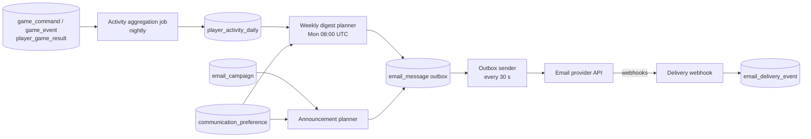

# Background Jobs, Analytics and Email

**Not in the MVP.** Not scheduled in the current roadmap; revisited with accounts and profiles in Phase 12. This document fixes the design so
earlier phases record the right data (notably `game_command` timestamps and game
results) and never mix communication logic into the simulation.

## 1. Purpose and non-purpose — APPROVED

- Background jobs exist for **product communication and player analytics**.
- They do **not** advance turns, and are not primarily for in-match notifications.
- Email and analytics logic stays outside the game simulation engine.
- No separate email microservice unless scale requires it.

## 2. Components



All jobs run inside the monolith with Spring `@Scheduled`, in the `analytics` and
`communication` modules. Each job is a thin trigger calling an application
service so it can also be invoked from tests and admin endpoints.

**Multi-instance safety** without extra infrastructure: planners take a
PostgreSQL advisory lock (`pg_try_advisory_xact_lock(<job id>)`) so only one
instance plans at a time; the sender claims rows with `FOR UPDATE SKIP LOCKED`.
(ShedLock is an acceptable alternative if more jobs appear.)

## 3. Activity tracking and analytics

### 3.1 What is recorded

Already produced by gameplay (no extra writes in game transactions):
- `game_command` (player, game, type, timestamp) — the activity signal.
- `player_game_result` — written when a game finishes/is abandoned
  (in the finishing transaction; it is game data, not communication).

Aggregated nightly into **player_activity_daily**:
| Column | Notes |
|---|---|
| player_id, day | PK |
| commands | count |
| active_seconds | estimated (below) |
| games_active | distinct games with commands |
| turns_ended | count |

**player_game_result**: `PK (game_id, player_id)`, `nation_template_id`,
`result` (`WIN`, `LOSS`, `ABANDONED`; values depend on Q-T2), `rounds_played`, `finished_at`.

### 3.2 Estimated time spent (PROPOSED, OPEN Q-A1)

Sessionize each player's command timestamps: consecutive commands < 10 minutes
apart belong to one session; session length = last − first + 2 minutes
(allowance for reading before the first command). Sum per day. This is honest
("estimated"), cheap, and needs no client tracking. A more accurate future option:
client heartbeats while the game tab is visible — requires explicit consent
review; not planned.

### 3.3 Weekly digest content

Computed for the previous ISO week (Mon–Sun, UTC):
- games played (games with ≥ 1 command), games finished
- estimated time played
- most played nation (by commands, ties by name)
- wins, losses, win rate (finished games only; lifetime win rate alongside)
- turns taken, battles won, cities captured (from `game_event`)
- "games waiting for you" (active seat = player) — a useful nudge, not a turn timer

Players with zero activity get no digest (PROPOSED) — avoids noise and protects
sender reputation.

## 4. Communication preferences and consent

**communication_preference**
| Column | Notes |
|---|---|
| player_id | PK |
| email | copied from the Supabase identity **only when** the player enables any email category; cleared when all are disabled |
| weekly_digest_opt_in | default **false** |
| product_news_opt_in | default **false** (promotional ⇒ explicit opt-in) |
| updated_at | |
| email_verified | from token claim at opt-in time |

- **Transactional vs promotional:** account-security mail is handled by Supabase
  Auth itself. Everything we send (digest, announcements) is treated as optional
  and requires opt-in.
- Each preference change is recorded (`communication_consent_log`: player, category,
  granted/revoked, timestamp, source) for auditability.
- **Unsubscribe:** every email contains a link with a signed, per-category token
  (HMAC of `player_id|category|issued_at`, no expiry needed for unsubscribe) and
  `List-Unsubscribe` + `List-Unsubscribe-Post: List-Unsubscribe=One-Click`
  headers (RFC 8058). Unsubscribe works without logging in and takes effect
  immediately; queued unsent messages of that category are cancelled.
- Provider-side suppression (bounces, complaints) is mirrored via webhooks:
  hard bounce or complaint → disable all categories for that address.
- **Data minimisation:** no email stored for players who never opt in; email
  content contains only aggregate stats; logs never include addresses (message id
  only); `email_message` payloads are purged after 90 days (status rows kept).
- Account deletion removes preferences, email, and anonymises analytics rows.

## 5. Outbox

**email_campaign** (announcements): `id`, `kind` (`PATCH_NOTES`, `FEATURE`,
`ANNOUNCEMENT`), `subject`, `body_markdown`, `category` (`product_news`),
`status` (`DRAFT`, `SCHEDULED`, `PLANNED`, `SENT`, `CANCELLED`),
`scheduled_for`, `created_by`.

**email_message**
| Column | Notes |
|---|---|
| id | uuid PK |
| dedupe_key | `UNIQUE` — e.g. `digest:{playerId}:{isoWeek}`, `campaign:{campaignId}:{playerId}` |
| player_id | |
| category | `weekly_digest`, `product_news` |
| template | template name + version |
| payload | jsonb (render data) |
| status | `PENDING`, `SENDING`, `SENT`, `FAILED`, `CANCELLED`, `SUPPRESSED` |
| attempts | integer |
| next_attempt_at | timestamptz; index `(status, next_attempt_at)` |
| provider_message_id | from provider |
| last_error | truncated text |
| created_at, sent_at | |

### 5.1 Planning (duplicate prevention, layer 1)

Planners insert with `INSERT … ON CONFLICT (dedupe_key) DO NOTHING`. Re-running a
planner (crash, redeploy, manual trigger) can never create a second digest for
the same player/week or a second copy of a campaign. Planning re-checks consent
at insert time.

### 5.2 Sending (duplicate prevention, layers 2–3)

```
loop every 30 s:
  BEGIN
    SELECT … FROM email_message
     WHERE status = 'PENDING' AND next_attempt_at <= now()
     ORDER BY next_attempt_at LIMIT 50
     FOR UPDATE SKIP LOCKED
    UPDATE … SET status = 'SENDING', attempts = attempts + 1
  COMMIT
  for each: re-check consent → call provider with Idempotency-Key = email_message.id
            → mark SENT (+ provider id) | schedule retry | FAILED
```

- Provider idempotency key (supported by e.g. Resend/Postmark-style APIs; choose
  a provider that supports it) makes a retry after an ambiguous timeout safe.
- Rows stuck in `SENDING` > 10 minutes (crash mid-send) are reset to `PENDING`;
  the provider idempotency key prevents a real duplicate.
- **Retry policy:** exponential backoff 1 min, 5 min, 30 min, 2 h, 12 h; max 5
  attempts; 4xx permanent errors (invalid address) → `FAILED` immediately.
- Rate limiting to provider limits by batch size and interval.

### 5.3 Delivery tracking

`POST /api/v1/webhooks/email/{provider}` verifies the provider signature, stores
`email_delivery_event` (`provider_message_id`, `type` delivered/bounced/complained/
opened?, `occurred_at`) idempotently (`UNIQUE (provider_event_id)`), and applies
suppression rules. Open/click tracking is **off** by default (privacy; OPEN Q-A2).

## 6. Provider choice (PROPOSED)

Any transactional+broadcast provider with an HTTP API, webhooks with signatures,
idempotency keys and EU/US region choice (e.g. Resend, Postmark, Amazon SES).
Integrated behind an `EmailSender` interface in `communication/infra`; a
`LoggingEmailSender` for local/dev; WireMock in integration tests. Templates
rendered server-side (e.g. a small Thymeleaf/Mustache template set) with a
plain-text alternative.

## 7. Testing

- Planner idempotency: run twice → one row per dedupe key.
- Consent: opted-out player never gets a row; opt-out after planning → `CANCELLED`.
- Sender: SKIP LOCKED with two concurrent senders → each message sent once.
- Retry/backoff state transitions with a fake clock.
- Webhook signature verification and idempotent event storage.
- Sessionization unit tests with edge cases (midnight boundaries, single command).
