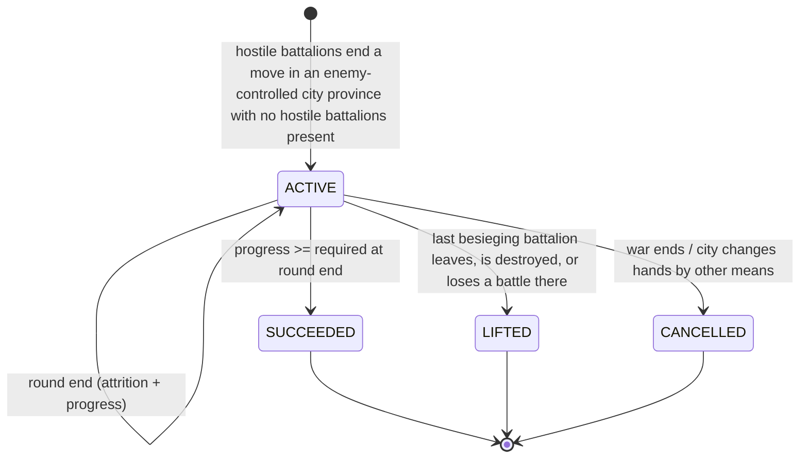
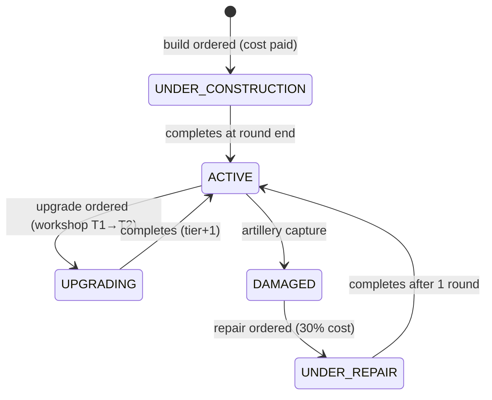

# Combat and Siege

Deterministic field combat, sieges, starvation, infrastructure damage and repairs.

Labels: **APPROVED** = specified by the product owner. **PROPOSED** = our model,
all numbers configurable and **not approved balance**. **OPEN** = needs a decision
(see [OPEN_QUESTIONS.md](OPEN_QUESTIONS.md)).

> Every number in §2–§4 is a PROPOSED starting coefficient. The worked examples
> were produced by a reference calculation of exactly the formulas below and are
> golden tests since Phase 5. If a coefficient changes, the examples are
> regenerated, never hand-edited.

## 0. Phase 5 implementation status (2026-10-18) — PROVISIONAL

The field-combat model of §2 is implemented as written, with its coefficients in the
versioned ruleset (`backend/src/main/resources/rulesets/<version>/military.json`, `combat`
and `units` sections) — **none of it is approved balance** (Q-C1 stays OPEN; only the river
×0.80 and mountain ×0.65 attacker multipliers are APPROVED).

| Part | Where | Notes |
|---|---|---|
| Battle engine §2.1–§2.7 | `military.rules.Battle` (pure Java, BigDecimal DECIMAL64, men floored) | Frontline protection, artillery exposure, cavalry terrain factor and flanking all active. Every example of §3 is a golden test (`BattleTest`), plus an exhaustive invariant grid (losses within manpower, sums, determinism) |
| Who fights §2.9 | `MilitaryService.move` | Attackers = the battalions of one move command (one province); defenders = **every** battalion of the other nation in the destination, including those recruited this turn (Q-M3). Q-C5 multi-province attacks are not implemented |
| Frontage §2.10 | — | None (Q-C4 default) |
| After the battle §2.8 | `MilitaryService`, `military.rules.Retreat` | As below; the report is stored as JSON in `battle_report` |
| Triggers | Move command | A battle happens only when a move enters a province holding the other nation's battalions; the whole command is one transaction (all losses, moves, retreat and the report, or nothing) |

**Phase 6 review (2026-10-19):** the engine was re-checked against 24 deterministic scenarios
([BALANCE_ANALYSIS.md](BALANCE_ANALYSIS.md)); no numerical defect was found, so the coefficients
and rulesets are unchanged. One report defect was fixed: when both armies break in the same
phase the result and the stored report now say so (`attackerBroke`, `defenderBroke`); the
winner rule (lower loss ratio) is unchanged. Battle losses are now also taken from each
battalion's origin cohorts (largest remainder, ties by origin city id), and the battle report
UI explains terrain, flanking, screen collapse and per-type losses.

**Phase 9 (2026-10-19, ruleset v5): war decides who fights.** A battle happens only against
battalions of a nation **at war** with the mover; allied or neutral battalions in the destination
stay out and keep their positions. Entering a province held by a nation one is not at war with is
refused unless it grants military access (`NO_MILITARY_ACCESS`). A retreat may not end where
battalions at war with the retreating nation stand (other foreign battalions do not block it). Simple
occupation, starting and continuing a siege all require war with the controller (`ControlDecision`
with an `atWar` predicate); after a peace treaty sieges are lifted and battalions without access
withdraw (DIPLOMACY.md §6.3). Battles with two or more enemy nations in one province are refused
(`COALITION_BATTLE_UNSUPPORTED`) in rulesets v1–v5; v6 fights coalition battles (§3a). Rulesets v1–v4 keep the old rule: every other nation is
hostile.

Temporary balancing assumptions (all PROVISIONAL, change by adding a ruleset version):

- Unit coefficients of §2.2, `lossPerDamage` 40, break at 30%, 3 phases, protection and
  exposure constants of §2.3, flank max +30% at a surplus of half the enemy army.
- Upkeep proportional to remaining manpower (ECONOMY §4); recruit costs 10 / 25 / 40 gold.
- Starting forces `3I 1C` (Q-W3) in ruleset v2.
- No pursuit, no reinforcement (Q-R1), no morale, no supply, no tech/doctrine modifiers
  (`techMod = doctrineMod = 1`).

---

## 1. Approved requirements (summary)

- Combat is deterministic. No tactical UI in MVP.
- Outcome depends on size, remaining manpower, composition, unit strength,
  attacker vs defender, terrain, river crossings, technology, doctrine, frontline
  protection, cavalry flanking, casualties.
- Not a simple sum of attack values; composition must matter.
- Infantry is the frontline and protects artillery. Artillery is dangerous when
  protected, very vulnerable when not. An all-artillery force is vulnerable.
- Cavalry has a meaningful flanking advantage, favoured by open terrain.
- River crossing: attacker −20% offence. Attacking defenders in mountains:
  attacker −35% offence. Doctrine may reduce these.
- Both sides suffer partial, deterministic casualties. Losers don't necessarily die.

---

## 2. Proposed field-combat model

### 2.1 Notation

For a side, let `I`, `C`, `A` be infantry, cavalry and artillery **strength in
battalion-equivalents** = total current manpower of that type ÷ 1,000
(a 650-man battalion counts 0.65). All arithmetic is `BigDecimal` with
`MathContext.DECIMAL64` (HALF_EVEN); casualties are floored to whole soldiers.

### 2.2 Unit coefficients (PROPOSED)

| Type | Attack | Defence (loss divisor) | Screen value | Notes |
|---|---|---|---|---|
| Infantry | 1.0 | 1.2 | 1.0 | Sturdy frontline |
| Cavalry | 1.4 | 0.9 | 0.5 | Terrain-sensitive, flanks |
| Artillery | 2.5 | 0.5 | 0 | Needs protection |

### 2.3 Frontline protection

```
screen = I × 1.0 + C × 0.5
P      = 1                         if A = 0
       = min(1, screen / (k × A))  otherwise        k = 1.0 (screen needed per artillery)
```

`P` (protection, 0..1) has two effects:

- **Artillery effectiveness** `artEff = 0.4 + 0.6 × P`. Unprotected guns are
  overrun and fire at 40% rate.
- **Artillery exposure** to enemy fire (§2.6) `= A × (0.2 + 1.3 × (1 − P))`.
  Protected guns sit behind the line (exposure weight 0.2 per battalion);
  unprotected guns are the front line (1.5 per battalion) *and* have a low defence.

Because `P` is recomputed every phase from current manpower, artillery becomes
vulnerable **as its infantry screen collapses** during a battle.

### 2.4 Cavalry and flanking

```
cavTerrain = 1.0 (plains) | 0.6 (mountains)
excessCav  = max(0, C_own − C_enemy)
flank      = 0.30 × flankTerrain × min(1, excessCav / (0.5 × enemyTotal))
             flankTerrain = 1 (plains) | 0 (mountains)
```

Flanking is a multiplier on the whole side's damage: the side whose cavalry
outnumbers the enemy's can envelop; at most +30% when its surplus cavalry equals
half of the enemy army. In mountains cavalry fights at 60% and cannot flank.

### 2.5 Damage per phase

```
base = I × 1.0 + C × 1.4 × cavTerrain + A × 2.5 × artEff
D    = base × (1 + flank) × terrainMod × techMod × doctrineMod
```

`terrainMod` applies **to the attacker only** (APPROVED values, multiplicative
combination PROPOSED):

| Condition | Multiplier |
|---|---|
| Crossing a river edge into the province | × 0.80 |
| Defender's province is mountains | × 0.65 |
| Both | × 0.52 |

**Phase 8 (implemented, PROVISIONAL values):** `techMod` per unit type comes from the nation's military
level (+10% at level 2, +20% at level 3) and doctrines reduce the attacker's penalties exactly as below
(Mountain Warfare and River Engineering halve them: × 0.825 and × 0.90). Both are supplied to the battle
engine as `Battle.SideModifiers` for each side; neutral modifiers reproduce every earlier result.

Doctrine reduces a penalty proportionally:
`effectivePenalty = basePenalty × (1 − doctrineReduction)`; e.g. 20% river
penalty with 25% reduction → 15% → × 0.85. `techMod` and `doctrineMod` are
`1.0` until Phase 8.

PROPOSED: multiplicative stacking (0.8 × 0.65) rather than additive (1 − 0.55)
— avoids reaching zero as more penalties are added later. The initial map
avoids river+mountain combinations anyway (APPROVED intent).

### 2.6 Casualties per phase

Damage `D` dealt by one side becomes `D × 40` "casualty points" (PROPOSED
`lossPerDamage = 40`), distributed over the **target** side by exposure weight,
then divided by the target type's defence:

```
w_I = I_t × 1.0     w_C = C_t × 1.0     w_A = A_t × (0.2 + 1.3 × (1 − P_t))
loss_type = floor( D × 40 × w_type / (w_I + w_C + w_A) / defence_type )
loss_type = min(loss_type, current manpower of type)
```

Within a type, losses are split across battalions proportionally to their
manpower using largest-remainder apportionment, ties by battalion id ascending.

Both sides compute damage from the **start-of-phase** state, then losses apply
simultaneously.

### 2.7 Battle sequence, breaking and outcome

- A battle has up to **3 phases** (PROPOSED `battle.maxPhases = 3`).
- After each phase, a side **breaks** if its cumulative losses reach **30%** of
  its starting manpower (PROPOSED `battle.breakThresholdBps = 3000`; doctrine may
  raise it). If one side breaks, the other wins immediately. If both break in the
  same phase, the lower loss ratio wins.
- If nobody breaks after 3 phases, the side with the **lower loss ratio**
  (losses ÷ starting manpower) wins. Exact ties go to the defender.
- Loss ratios are compared exactly by cross-multiplication (`lossA × initB` vs
  `lossB × initA`), never by division.

### 2.8 After the battle (PROPOSED; retreat is OPEN Q-C2)

Retreat defaults below were accepted as provisional MVP rules (Q-C2, Q-C3, 2026-10-17).

- **Attacker wins:** the attacking battalions enter the province; defenders retreat.
- **Defender wins:** the attacking battalions stay in their origin province (the
  move fails; each attacking battalion's movement for the turn is spent).
- **Defender retreat:** all defending battalions retreat together to an adjacent
  province controlled by their nation **that holds no battalions of another nation**
  (judged after the victorious attackers have entered); choice: the one with most friendly
  battalions, then lowest province key (implementation detail, 2026-10-18: keys are the
  stable, human-readable identifiers; ids are random UUIDs). If none exists, they are
  **destroyed** (survivors lost). Retreating does not consume the retreating battalions'
  own movement eligibility for their next turn, and retreating battalions keep their army.
- **Losses within a type** are split over its battalions in proportion to their manpower:
  floors first, then the remaining soldiers go to the largest fractional remainders, ties by
  battalion id (as text). Dead soldiers never return to the civilian population.
- Battalions at 0 manpower are removed. Armies with no battalions are removed.
- PROPOSED MVP: no pursuit casualties. Later option: winner's surplus cavalry
  inflicts pursuit losses on the retreating army.
- A battle produces a persisted `battle_report` with per-phase numbers.

### 2.9 Who fights (PROPOSED; OPEN Q-C5)

- Battles trigger immediately when a selection of battalions moves into a
  province containing battalions of a nation it is at war with (pre-diplomacy:
  every other nation).
- Defender side = **all** hostile battalions in that province, regardless of army
  grouping and **including battalions recruited this round** (APPROVED: new
  recruits defend immediately, Q-M3).
- Attacker side = the moving selection (one move command; it may contain
  battalions from several armies of the same province). Attacks combining
  battalions from different provinces are a later feature.
- Besieging battalions attacked by a relief force are the **defenders** of that
  battle (they are positioned in the province).

### 2.10 Frontage — OPEN Q-C4

MVP: no frontage limit (all battalions engage). Proposed later rule: frontage
20 battalions on plains, 12 in mountains per side; excess infantry/cavalry stand
in reserve and replace losses between phases. Deferred because it only matters
for very large armies.

---

## 3. Worked combat examples (PROPOSED model)

Notation: `6I 2C 2A` = 6 infantry, 2 cavalry, 2 artillery full battalions.

### Example 1 — Combined arms vs infantry-heavy, plains

Attacker A `6I 2C 2A` (10,000) vs defender B `8I 2C` (10,000), plains, no river.

**Phase 1.**
A: screen = 6 + 1 = 7 ≥ 2 → P = 1, artEff = 1.0.
base = 6×1.0 + 2×1.4 + 2×2.5 = **13.8**; flank 0 (equal cavalry). D_A = 13.8.
B: base = 8 + 2.8 = **10.8**. D_B = 10.8.

Losses to B: 13.8 × 40 = 552 points, weights I 8, C 2 (Σ 10):
infantry 552×0.8/1.2 = **368**, cavalry 552×0.2/0.9 = 122.67 → **122**. Total 490.
Losses to A: 10.8 × 40 = 432, weights I 6, C 2, A 2×0.2 = 0.4 (Σ 8.4):
infantry 432×6/8.4/1.2 = 257.14 → **257**, cavalry 432×2/8.4/0.9 → **114**,
artillery 432×0.4/8.4/0.5 → **41**. Total 412.

| After phase | A (I/C/A) | A lost | B (I/C) | B lost |
|---|---|---|---|---|
| 1 | 5,743 / 1,886 / 1,959 | 412 (4.1%) | 7,632 / 1,878 | 490 (4.9%) |
| 2 | 5,499 / 1,779 / 1,919 | 803 (8.0%) | 7,277 / 1,762 | 961 (9.6%) |
| 3 | 5,266 / 1,679 / 1,880 | 1,175 (11.8%) | 6,934 / 1,652 | 1,414 (14.1%) |

No side breaks. **A wins** on loss ratio (11.8% vs 14.1%). B retreats with
8,586 soldiers — a defeat, not an annihilation. Protected artillery lost only
120 men while providing 36% of A's damage. (In phase 2, A's cavalry is 8 men
stronger than B's, producing a negligible +0.05% flank — the formula is continuous.)

### Example 2 — Same armies, attacking across a river into mountains

Terrain multiplier for A = 0.8 × 0.65 = 0.52; A's cavalry ×0.6; no flanking.
Phase 1: D_A = 12.68 × 0.52 = 6.594; D_B = 8 + 2×1.4×0.6 = 9.68.

| After phase | A lost | B lost |
|---|---|---|
| 1 | 368 (3.7%) | 233 (2.3%) |
| 2 | 727 (7.3%) | 459 (4.6%) |
| 3 | 1,078 (10.8%) | 678 (6.8%) |

**B wins.** A stays on its side of the river.

**Example 2b — overwhelming the position.** Attacker `10I 2C 4A` (16,000) vs the
same B: A loses 1,057 (6.6%), B loses 1,176 (11.8%). **A wins** — terrain makes
attacks costly but not impossible; it takes ~60% more troops.

### Example 3 — All-artillery army

Attacker `6A` (6,000) vs defender `6I` (6,000), plains.
A: screen 0 → P = 0 → artEff 0.4 → base = 6 × 2.5 × 0.4 = **6.0** (same as 6
infantry, at four times the cost). A's exposure weight 1.5 per battalion and
defence 0.5: losses = 240 points / 0.5 = 480 per phase.

| After phase | A lost | B lost |
|---|---|---|
| 1 | 480 (8.0%) | 200 (3.3%) |
| 2 | 944 (15.7%) | 384 (6.4%) |
| 3 | 1,393 (23.2%) | 552 (9.2%) |

**B wins** decisively.

**Example 3b — the same guns, protected.** Attacker `3I 3A` vs `6I`: P = 1 at
the start, A deals 10.5 per phase vs 6.0. Result: A loses 717 (12.0%), B loses
1,000 (16.7%). **A wins.** As A's infantry thins, P drops (0.971 → 0.948) and
artillery losses rise each phase (80 → 89 → 93) — the collapse mechanic in action.

### Example 4 — Cavalry flanking, plains vs mountains

Attacker `4I 4C` (8,000) vs defender `7I 1C` (8,000).

- **Plains:** excessCav = 3, enemy half-size = 4 → flank = 0.3 × 0.75 = +22.5%.
  D_A phase 1 = 9.6 × 1.225 = 11.76 vs D_B = 8.4.
  Final: A lost 926 (11.6%), B lost 1,174 (14.7%) → **A wins.**
- **Mountains:** no flank, cavalry ×0.6, terrain ×0.65 → D_A = 4.78 vs D_B = 7.84.
  Final: A lost 892 (11.2%), B lost 477 (6.0%) → **B wins.**

Same armies, opposite results: composition must suit terrain.

### Example 5 — Rout (break threshold)

Attacker `10I 4C 4A` (18,000) vs defender `4I` (4,000), plains.
Flank = 0.3 × min(1, 4 / 2) = +30%. D_A = 25.6 × 1.3 = 33.28.
Phase 1: B loses 1,109 (27.7%), A loses 155. Phase 2: B reaches 2,209 (55.2%)
→ **B breaks after phase 2**, retreats with 1,791 soldiers. A lost 266 (1.5%).

---

## 3a. Coalition battles, attached battalions and movement per round (Phase 10, ruleset v6) — PROVISIONAL

**Who fights.** A move into a province is an attack when battalions of nations **at war with the
commanding nation** stand there. All of them defend together, whichever nation they belong to —
allies need no attachment to defend side by side. Battalions of nations not at war with the
commander stay out of the battle. Rulesets v1–v5 keep the one-against-one rule
(`COALITION_BATTLE_UNSUPPORTED`).

**No merged nation.** Each battalion fights with **its own nation's** technology and doctrine
(§2.5). The side's damage is computed per group of battalions sharing the same modifiers:

```
D_side = Σ_groups (base_g × terrainMod_g) × (1 + flank_side)
```

where `base_g` is the group's unit damage (with its technology bonus) and `terrainMod_g` its river and
mountain multipliers (with its doctrines); flanking and protection are judged for the whole side. A
side of one nation, or of nations with equal modifiers, is exactly the formula of §2.5, so every
golden example above is unchanged. Losses are distributed to battalions by the existing rules and
booked on the battalion that took them; cohorts shrink with their battalion (§4, GAME_DESIGN §7.6), so soldiers
always stay attributed to their origin cities.

**Outcome per nation.** After the battle each nation's surviving battalions retreat or are destroyed
by the normal rules, nation by nation (a nation retreats to a province it may enter). The report
lists every battalion with its nation and one line per nation: soldiers before, losses, retreat
province or destruction, modifiers. The report's `attackerNationId` is the commanding nation; its
`defenderNationId` is the defending nation with most soldiers (ties: lowest id) — only a label.

**Occupation and sieges.** Several nations at war with the controller may stand in its province
together; if no nation present is at war with any of them, the nation with most soldiers present
(ties: lowest id) occupies or leads the siege (`ControlDecision`, coalition rule). Siege artillery
counts only the besieger's own battalions.

**Attached battalions.** On its turn an owner may lend battalions to a nation it has an active
alliance with or fights beside in an active war (`POST /attachments`; `features.attachments`):

- the **commander** may only **move and attack** with them, together with its own battalions; it
  cannot recruit, reinforce, disband or regroup them; a lent battalion only fights nations its own
  nation is at war with (`ATTACHED_NOT_AT_WAR`);
- the **owner** keeps paying upkeep, cannot move it while lent (`BATTALION_ATTACHED`), and may recall
  it on its own turn (`POST /attachments/release`);
- an attachment ends by itself when owner and commander are no longer allied or fighting together,
  when either leaves the war by separate peace, or when either is eliminated.

**Movement per global round.** In v6 (`military.roundBasedMovement`) a battalion moves **at most once
per global round, whoever commands it**: moving, attaching, detaching or recalling never gives it a
second move in the same round. Recruited or reinforced battalions wait for the next round. Rulesets
v1–v5 keep eligibility per player turn (§9a of TURN_SYSTEM), which is the same for a battalion only
its owner commands.

## 4. Reinforcement — implemented in Phase 6 (option A, rules accepted 2026-10-19)

**As implemented** (`military.rules.Reinforcement`, `BattalionService.reinforce`):

- The active player reinforces one own battalion standing in a province whose city its nation
  **owns and controls**; the replacements come from **that city**. Not in a besieged city (`CITY_BESIEGED`, checked since Phase 7).
- At most **500** replacements per battalion per player turn (`reinforcementPerTurn` in the
  ruleset), never above `max_manpower` (1,000). Several smaller reinforcements in one turn add up
  to the same 500.
- Cost = the unit's recruitment cost pro rata, **rounded up** to whole milligold (PROPOSED; the
  option table below said floor — ceiling makes splitting a reinforcement never cheaper; with the
  current costs 10 / 25 / 40 mg per soldier the division is exact anyway). Example: 350 infantry
  replacements = 10,000 × 350 / 1,000 = **3,500 mg (3.5 gold)** and exactly 350 civilians.
- Blocked while `IN_ARREARS`; the city must keep 1,000 civilians, as for recruitment (PROPOSED,
  ECONOMY §8a).
- **PROVISIONAL tactical rule:** a battalion reinforced in a turn may not move or attack for the
  rest of that turn (eligibility `REINFORCED_THIS_TURN`); it still defends. A battalion that has
  already moved may still be reinforced (its movement was spent anyway).
- Soldiers join the battalion's cohort for that city (origin tracking, GAME_DESIGN §7.6), so
  disbanding later returns them to the city that gave them.

APPROVED: damaged battalions can eventually be reinforced, consuming civilian
population and gold. Lost manpower is never restored automatically.

The options considered:

| Option | Location | Source of men | Rate | Cost | Trade-off |
|---|---|---|---|---|---|
| **A (recommended default)** | Army in a province whose city is controlled by own nation, not besieged | That city | up to 500 men per battalion per turn | recruitment cost × men / 1,000 (floor mg) | Simple, keeps fronts dynamic |
| B | Only in the battalion's origin city | Origin city | full refill | same | Very readable, but forces long marches |
| C | Anywhere in own/allied territory, "supply" range ≤ 2 provinces from an own city | Nearest own city | 250/turn | +25% surcharge | Richer, needs supply logic |

Under any option: reinforcing is a player action during their turn, deducts
population immediately (like recruitment), never exceeds `max_manpower`, and is
blocked while `IN_ARREARS`. `origin_city_id` is not changed by reinforcement; mixed origins are
tracked as cohorts (decided in Phase 6 to prevent population teleportation on disband).

---

## 5. Sieges

### 5.0 Phase 7 implementation status (2026-10-19) — PROVISIONAL coefficients

Implemented as the PROPOSED model of §5.3–§5.7 (all numbers in `rulesets/v3/siege.json`; none is
approved balance), in the `siege` module (`siege.rules.SiegeMath`, `ControlDecision`,
`FortressWorks`; `SiegeEngine` applies them).

**Unified occupation policy** (replaces the temporary Q-M7 behaviour; one round phase, step
`SIEGES`, decides control for every province in key order):

| Province | Who stands there | Result |
|---|---|---|
| any | battalions of two nations | impossible: field combat resolves it first |
| unfortified (no fortress, a level-0 project, or a DAMAGED fortress) | only nation N ≠ controller | simple occupation at round end: controller := N (Phase 5 rule) |
| fortified (fortress ACTIVE, level ≥ 1) | only nation N ≠ controller | a siege — started at once when N's move or won battle establishes it, otherwise at round end |
| besieged | the besieger's battalions | the siege continues |
| besieged | nobody of the besieger (withdrew, destroyed, beaten by relief) | the siege is LIFTED immediately (or at round end); progress lost (Q-S8) |

Ownership never changes; the besieged controller keeps control until the siege succeeds; the
province is never "captured" and "besieged" at once (one active siege per province, enforced by
a partial unique index). Liberating your own city held by an enemy behind an intact fortress
needs a siege too; after an artillery capture the fortress is DAMAGED (effective level 0), so a
liberator simply occupies it.

**Per round end, per active siege** (exactly once: `siege.last_processed_round` and the
`siege_round` primary key, inside the `round_resolution`-guarded transaction):

1. Attrition: `loss = floor(population × 500 / 10,000)` civilians removed from the city
   (APPROVED ≈5%; Q-S7: also in the round it falls). Civilian deaths are never counted as
   battalion casualties.
2. Progress: `+ (100 + floor(50 × artilleryManpower / 1,000))`, artillery = surviving manpower of
   the besieger's artillery in the province *now* (summed before flooring, so splitting or
   regrouping batteries gains nothing; reinforcements or losses count from the next round end).
3. Fall when `progress ≥ (5 + level) × 100`: artillery siege if any besieger artillery was present
   at the fall (Q-S2) → fortress DAMAGED (integrity 0) and one ACTIVE workshop DAMAGED (highest tier,
   ties lowest id as text; none → nothing, Q-S3); without artillery nothing is damaged; a running
   fortress upgrade is lost. Control passes to the besieger; the siege is SUCCEEDED.

Golden tests reproduce the §5.3 duration table and the §5.4 attrition table exactly; the
PostgreSQL tests play a level-1 siege to the end: 6 rounds and 8,000 → 5,883 people without
artillery, 3 rounds and 6,859 people with two batteries (fortress and workshop damaged).

**Siege Engineering (Phase 8, PROVISIONAL):** the besieger's doctrine raises only the artillery part of
the progress: `100 + floor(50 × artilleryManpower × (10,000 + 5,000) / (1,000 × 10,000))` — two batteries
add 150 instead of 100 per round (a level 2 fortress falls in 3 rounds instead of 4); a siege without
artillery is not sped up. Read at each round end from the besieger's current research.

**Besieged cities (PROVISIONAL, Q-S11):** no recruitment, reinforcement, workshop construction,
workshop or fortress repair, fortress construction or upgrade; battalions may not disband inside a
besieged province; a cohort whose origin city is besieged settles in the local city on disband
(fallback). A fortress project that falls due during a siege waits until the siege ends. The city
keeps producing income for its controller during the siege (Q-S6); there is no garrison (Q-S9).

Fortress levels (v3, PROVISIONAL): level n costs 50 gold × n to reach (from n − 1), takes 2
rounds, costs 1 gold × n upkeep per round, integrity 100 × n; levels 1–3. Repair: 30% of the cost
of the current level (level 1 → 15 gold, level 2 → 30 gold), 1 round. Starting fortresses (new v3
games): Varnhold and Ostrava 2; Greyspire, Kaldric, Elmsford, Sablewater 1; others none.

### 5.1 Approved rules

- Cities can have fortress levels; higher levels make capture harder.
- Sieges last multiple **global rounds**; there is no manual assault button.
- More artillery → faster siege; higher fortress level → slower.
- Zero artillery can still besiege, slowest method (intended ~6–8 rounds
  depending on fortress level).
- Every round of an active siege, the city loses ~5% of its remaining civilians.
- No-artillery capture: fortress and workshops intact.
- Artillery capture: fortress damaged; one workshop damaged if one exists.
- Damaged workshops: no production; repair = 30% of new cost, 1 round.
- Damaged fortresses must be repairable (cost not finalized).

### 5.2 The duration inconsistency — must be decided (Q-S1)

Original formula: `rounds = max(1, ceil(fortress_level × 3 − siege_units))`.

| Fortress | S = 0 | S = 1 | S = 2 | S = 4 |
|---|---|---|---|---|
| 1 | **3** | 2 | 1 | 1 |
| 2 | 6 | 5 | 4 | 2 |
| 3 | 9 | 8 | 7 | 5 |

Conflicts with the intended "no-artillery sieges take 6–8 rounds":

1. Level 1 with no artillery takes **3** rounds, not 6–8.
2. Level 3 with no artillery takes **9** rounds, above the range.
3. Artillery has *linear, absolute* effect: 2 guns halve a level-1 siege
   but barely touch a level-3 siege (9 → 7), the opposite of "artillery is the
   fast way" at high levels.
4. `ceil` of an integer expression is redundant — suggesting the formula was
   meant to involve fractional strength.
5. The formula yields a duration fixed at siege start; it doesn't say what
   happens when artillery arrives, dies or leaves mid-siege.

### 5.3 Proposed formula — progress points (PROPOSED)

A siege accumulates **progress points** each round; the city falls when progress
reaches the requirement.

```
required = (BASE + PER_LEVEL × F) × 100          BASE = 5, PER_LEVEL = 1   (F ≥ 1)
required = 100                                    F = 0 (unfortified)
progress per round = 100 + floor(50 × artilleryManpower / 1000)
```

`artilleryManpower` = total current manpower of artillery battalions in all
participating armies at the moment of round processing (a 650-man battery
contributes 32 points).

Resulting durations (`ceil(required / progress)`):

| Fortress | S = 0 | S = 2 | S = 4 | S = 6 |
|---|---|---|---|---|
| 0 | 1 | 1 | 1 | 1 |
| 1 | **6** | 3 | 2 | 2 |
| 2 | **7** | 4 | 3 | 2 |
| 3 | **8** | 4 | 3 | 2 |

Properties: matches the 6–8 intent exactly; artillery has diminishing returns
(the 1st gun saves more rounds than the 6th); handles mid-siege changes naturally
(progress is cumulative, rate recomputed every round); all four constants are
configuration. Alternative B (keep original, special-case S = 0 → `5 + F`) is
simpler to explain but discontinuous and keeps problem 3.

### 5.4 Population attrition (APPROVED ~5%, PROPOSED rounding)

Each round-end while the siege is active (including the round it falls):
`loss = floor(population × 500 / 10 000)`.

12,000-person city, fortress level 2:

| Round | No artillery (7 rounds) | 2 artillery (4 rounds) |
|---|---|---|
| 1 | −600 → 11,400 | −600 → 11,400 |
| 2 | −570 → 10,830 | −570 → 10,830 |
| 3 | −541 → 10,289 | −541 → 10,289 |
| 4 | −514 → 9,775 | −514 → **9,775 falls** |
| 5 | −488 → 9,287 | |
| 6 | −464 → 8,823 | |
| 7 | −441 → **8,382 falls** | |
| **Total lost** | **3,618 (30.2%)** | **2,225 (18.5%)** |

| Outcome | Starvation (S = 0) | Artillery (S = 2) |
|---|---|---|
| Rounds | 7 | 4 |
| Population left | 8,382 | 9,775 |
| Fortress | intact (level 2) | DAMAGED |
| Workshops | intact | one DAMAGED |

This is the approved trade-off: slow sieges preserve infrastructure but devastate
people; artillery saves 1,393 people but costs a fortress repair and a workshop repair.

Level 1 no artillery: 6 rounds, 8,823 left. Level 3 no artillery: 8 rounds, 7,963 left.

### 5.5 Siege state machine (PROPOSED)



- **Start:** automatic when battalions enter (by move or won battle) a province
  whose city is controlled by a hostile nation and no hostile battalions remain
  there. No separate "besiege" action (PROPOSED; OPEN Q-S2b).
- **Participants:** derived, not stored — every battalion of the besieging nation
  located in that province at round processing, whatever army it belongs to.
  Battalions arriving later contribute their artillery at the next round end.
  Multi-nation sieges (allies) are OPEN Q-S10.
- **Withdrawal:** moving battalions out removes them from the siege. If no
  besieging battalion remains, the siege is LIFTED. PROPOSED: **progress is lost**
  when lifted (OPEN Q-S8). Population already lost stays lost.
- **Relief:** a relief army attacking the besiegers fights a normal battle with
  the besiegers as defenders. If besiegers lose and retreat, the siege is LIFTED.
- **Reinforcing besiegers:** allowed under the reinforcement rule if the
  province is friendly-controlled — it isn't during a siege, so PROPOSED:
  besiegers cannot be reinforced in place.
- **Defending city:** PROPOSED no garrison in MVP; the city itself does not fight
  (OPEN Q-S9). Fortress level only affects siege duration.
- **Recruitment in a besieged city:** forbidden (PROPOSED).

### 5.6 Fall of the city (PROPOSED details)

At round end when progress ≥ required:

1. Classify the siege: **artillery siege** if any participating artillery
   manpower > 0 at the fall round; otherwise **starvation siege** (OPEN Q-S2).
2. Artillery siege: fortress (if level ≥ 1) → `DAMAGED`; the highest-tier
   ACTIVE workshop, ties by lowest building id, → `DAMAGED` (OPEN Q-S3).
   Already-damaged workshops don't count; if no ACTIVE workshop, nothing happens.
3. **Control** transfers to the besieging nation. Legal ownership never changes
   on capture (APPROVED, Q-W1); it changes only through a peace treaty.
   The occupied city yields no income to either nation (APPROVED, Q-W2) until liberated or
   transferred by treaty.
4. Any projects under construction in the city are cancelled (PROPOSED).
5. Battalions whose `origin_city_id` is this city keep it; disbanding will
   fall back to the local city while the origin is not friendly (APPROVED rule
   handles this).
6. A `siege_report` / history event is recorded.

### 5.7 Damage and repair state model (PROPOSED)

Applies uniformly to workshops and fortresses (`building.status`):



- DAMAGED/UNDER_REPAIR workshop: capacity 0. DAMAGED fortress: PROPOSED
  effective level 0 for siege requirements and no upkeep (OPEN Q-S4).
- Being captured while UNDER_REPAIR: PROPOSED the repair continues for the new
  controller (payment already made) — simplest; OPEN.
- A DAMAGED building can be damaged again? No-op (already damaged).
