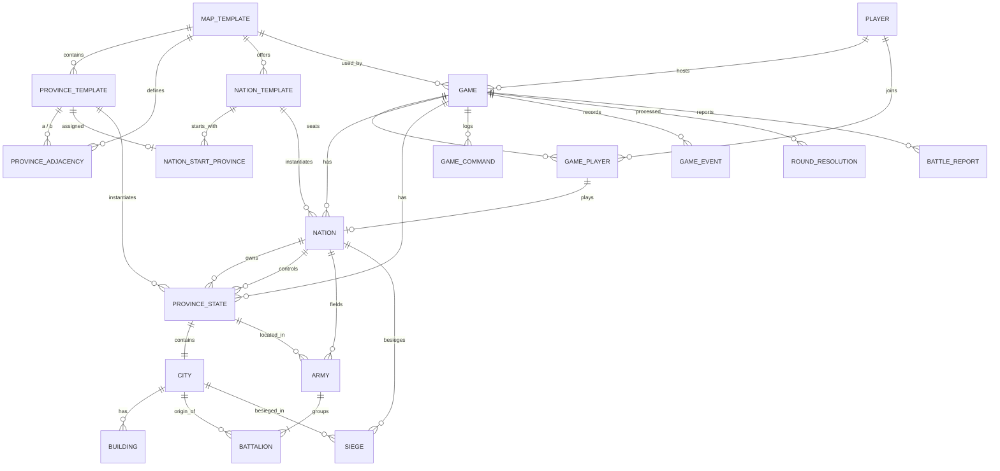

# Data Model

PostgreSQL relational model. Tables are introduced by phase; nothing is created
before the phase that needs it. All DDL ships as Flyway migrations.

## 1. Conventions

- **Primary keys:** `uuid`, generated by the application (random v4 today; UUIDv7 for index
  locality is a later optimisation). Exceptions: append-only logs use `bigint generated always as identity`;
  pure join tables use composite PKs.
- **Per-game isolation:** every per-game table has `game_id NOT NULL`, and a
  `UNIQUE (game_id, id)` constraint so that other per-game tables reference it
  with a **composite foreign key** `(game_id, x_id) → x(game_id, id)`. The
  database then *cannot* store an army of game A in a province of game B.
- **Money:** `bigint` milligold, column suffix `_mg`, `CHECK (… >= 0)` where
  negatives are illegal. **Population/manpower:** `integer`, `CHECK (>= 0)`.
- **Enums:** `varchar` + `CHECK (col IN (…))` (easy to migrate; maps to Java enums
  via `@Enumerated(STRING)`).
- **Time:** `timestamptz`, set from the injected `Clock`. Game logic uses
  `round`/`turn_number`, never wall time.
- **Indexes:** every FK column is indexed (PostgreSQL doesn't do it automatically)
  unless a composite unique index already leads with it.
- **JPA mapping:** entities reference other aggregates by id (`UUID nationId`),
  not deep object graphs; composite FKs are enforced by the DB. Associations are
  mapped only inside an aggregate (army → battalions). Open-session-in-view off.
- **Schema:** `game` (not exposed to Supabase Data API; RLS enabled, no policies).

## 2. Static vs mutable state

| Category | Tables | Mutated by gameplay? |
|---|---|---|
| Static world templates | `map_template`, `province_template`, `province_adjacency`, `nation_template`, `nation_start_province` | **Never** (only by migrations/import tool; published templates immutable — new version instead) |
| Accounts | `player` | Profile edits only |
| Game membership | `game`, `game_player` | Lobby + game lifecycle |
| Per-game mutable world | `nation`, `province_state`, `city`, `building`, `army`, `battalion`, `siege` | Command pipeline / round processing only |
| Per-game history | `game_command`, `game_event`, `round_resolution`, `battle_report`, `game_incident` | Append-only |
| Later: progression & diplomacy | `nation_research`, `diplomatic_relation`, `war`, `war_participant`, `peace_treaty`, `peace_term`, `tribute_obligation` | Command pipeline / round processing |
| Later: analytics & communication | `player_game_result`, `player_activity_daily`, `communication_preference`, `email_campaign`, `email_message`, `email_delivery_event` | Background jobs only |

Concepts kept distinct:

- **Authenticated user** = Supabase `auth.users` row (not ours) ↔ `player.supabase_user_id`.
- **Game-specific player** = `game_player` (seat, status).
- **Nation ownership** = `nation.game_player_id` (who plays it) and
  `province_state.owner_nation_id` (legal territory).
- **Territorial military control** = `province_state.controller_nation_id`.

## 3. Tables

### 3.0 As implemented (migrations V1–V11)

The sections below describe the target model; this is what exists today.

| Migration | Tables / changes |
|---|---|
| `V1__baseline` | schema `game` |
| `V2__players_and_lobbies` | `player`, `game` (lobby columns), `game_player` |
| `V3__world_templates` | `map_template` (key, version, name, view_box, max_players), `province_template` (key, name, terrain, svg_path, label_x/y, city_name, start_population), `province_adjacency` (stored once with `a < b`, `crossing` NONE/RIVER, `river_svg_path` iff RIVER), `nation_template` (key, name, colour, capital), `nation_start_province` (≤ 1 nation per province). Composite FKs keep every reference on the same map |
| `V4__seed_sundered_reach_map` | Data: *The Sundered Reach* v1 — 12 provinces, 17 adjacencies (2 river crossings), 2 nations × 6 provinces. Never edited; a changed map is a new version |
| `V5__game_start_and_turns` | `game` + `map_template_id`, `current_round`, `active_seat`, `turn_number`, `state_version`, `started_at`, `last_action_at`, status `IN_PROGRESS` and lifecycle CHECKs; `game_player` + `nation_template_id` (`UNIQUE (game_id, nation_template_id)`); per-game `nation`, `province_state` (owner and controller, both NOT NULL until neutral land exists), `city` (name, population); `game_command`; `round_resolution` |
| `V6__economy` | `game.ruleset_version` (backfilled `v1`); `game_command.result_ref` and type `BUILD_WORKSHOP`; `nation_economy` (treasury_mg `>= 0`, in_arrears; composite FK to `nation`); `building` (WORKSHOP only, `level` = tier 1–2, status `UNDER_CONSTRUCTION`/`ACTIVE`/`DAMAGED`, `ordered_round`, `completes_after_round` required while under construction, `cost_paid_mg`; composite FK to `city`); `economy_round_report` (PK game, round, nation; FK to `round_resolution`). Backfill: games started before V6 get 50 gold per nation and one active Tier 1 workshop in each capital |

| `V7__military` | `game_command` types + `RECRUIT`, `MOVE`, `REGROUP`; `army` (nation, name 1–40 chars; `UNIQUE (game_id, id, nation_id)` so a battalion can only join an army of its own nation); `battalion` (unit_type INFANTRY/CAVALRY/ARTILLERY, `manpower` `> 0` and `<= max_manpower` — a destroyed battalion is deleted, never kept at 0 —, `max_manpower`, `origin_city_id`, `province_state_id` (location), nullable `army_id`, `equipment_level` 0, `recruitment_cost_mg`, `recruited_round`, `recruited_turn_number`, nullable `last_moved_turn_number`; composite FKs to `nation`, `city`, `province_state` and `(game_id, army_id, nation_id)` → `army`); `battle_report` (round, turn, province, attacker and defender nation, winner, ruleset version, `report` JSONB with inputs, phases and outcome). No backfill: running games get no battalions and keep ruleset v1 |
| `V8__reinforcement_and_cohorts` | `game_command` types + `REINFORCE`, `DISBAND`; `battalion` + `last_reinforced_turn_number`, `reinforced_this_turn` (`0..max_manpower`); `battalion_cohort` (battalion, origin city, `soldiers > 0`, `UNIQUE (battalion_id, origin_city_id)`, composite FKs, `ON DELETE CASCADE` from the battalion) — the cohorts of a battalion always add up to its manpower (checked by the application in every command); `manpower_transfer` (append-only REINFORCE/DISBAND records with JSON details; unique DISBAND per battalion; no FK to the battalion so history outlives it). **Backfill:** every existing battalion gets one cohort = its manpower from its `origin_city_id`; nothing else changes |
| `V9__sieges_and_fortifications` | `game_command` types + `BUILD_FORTRESS`, `REPAIR_FORTRESS`, `REPAIR_WORKSHOP`; `building` status + `UNDER_REPAIR` with `repair_ordered_round`, `repair_completes_after_round`, `repair_cost_paid_mg`; `fortification` (one per city, `UNIQUE (game_id, city_id)`; `level` 0–10 — 0 only while the first level is an UPGRADE project —, `status` ACTIVE/DAMAGED, `integrity` 0..`max_integrity`, at most one `project` UPGRADE/REPAIR with target level, order and completion rounds and cost, `ruleset_version`); `siege` (province, city, besieger and defender nation, fortress level and required progress at start, `progress`, status ACTIVE/SUCCEEDED/LIFTED, start round/turn, `last_processed_round`, end round and reason, `artillery_siege`, `damaged_building_id`, `population_lost`; partial unique index: one ACTIVE siege per province; composite FKs); `siege_round` (PK siege + round: artillery, progress added/after, population before/lost). **No backfill:** running games keep their ruleset and get no fortress rows |
| `V10__research_and_growth` | `game_command` types + `UPGRADE_WORKSHOP`, `BUILD_INSTITUTION`, `UNLOCK_TECHNOLOGY`, `UNLOCK_DOCTRINE`; `building` + `upgrade_target_tier` (= level + 1, only while ACTIVE), `upgrade_ordered_round`, `upgrade_completes_after_round`, `upgrade_cost_paid_mg`; `institution` (city, type MILITARY_ACADEMY/UNIVERSITY/BARRACKS, status UNDER_CONSTRUCTION/ACTIVE, order and completion rounds, cost, ruleset version; `UNIQUE (game_id, city_id, type)`); `nation_research` (PK nation: three point pools `>= 0`, military and civilian level `>= 1`, ruleset version); `nation_doctrine` (nation, key, tier, cost, round; unique per nation and key); `research_round_report` (PK game, round, nation: points gained; FK to `round_resolution`); `research_unlock` (technology and doctrine purchases, the recorded answer to retries); `population_growth` (PK game, round, city: population before and growth). **No backfill:** running v1–v3 games get no research rows, keep their workshops and never grow |
| `V11__diplomacy_and_victory` | `game_command` types + `DECLARE_WAR`, `PROPOSE_ALLIANCE`, `ACCEPT_ALLIANCE`, `REJECT_ALLIANCE`, `END_ALLIANCE`, `PROPOSE_PEACE`, `ACCEPT_PEACE`, `REJECT_PEACE`, `COUNTER_PEACE`, `CANCEL_PEACE`; `game.status` + `FINISHED` (keeps round and seat: `game_turn_state_ck` covers IN_PROGRESS and FINISHED); `game_result` (PK game: finishing round, reason, outcome WINNER/DRAW ⇔ winner nation, ruleset, statistics JSONB) and `game_result_standing` (PK game, nation; player id, rank, score, provinces, population, treasury — ready for Phase 12 statistics); `diplomacy_game` (PK game: marks v5+ games; absent = permanent war); `alliance` (kind NORMAL/DEFENSIVE, pair, proposer, status PROPOSED/ACTIVE/REJECTED/CANCELLED/EXPIRED/ENDED, rounds; partial unique index on the unordered pair while PROPOSED or ACTIVE); `war` (leaders, ACTIVE/ENDED with round, turn and reason) with `war_participant` (side, join reason) and `war_front` (every pair fighting each other; partial unique index on the unordered pair while active — no duplicate wars); `war_score_event` (battle/siege points fixed at the event; `UNIQUE (war_id, kind, source_id)`); `peace_proposal` (terms JSONB, creation round/turn/state version, status, counter-of; one PENDING per war and proposer); `peace_treaty` (unique per war and per proposal); `truce` (pairs and last round); `tribute` (payer, receiver, rate, rounds total/charged, paid total; COMPLETED ⇔ all rounds charged) and `tribute_payment` (PK tribute, round: gross income, due, paid ≤ due); `diplomacy_event` (public history). All per-game, composite FKs `(game_id, …)`. **No backfill:** running v1–v4 games get no diplomacy rows, stay at permanent war and never finish |

Not yet created: `game_event`, `game_incident` — each arrives with its phase. Fortresses live in their own `fortification` table rather than as `building` rows of type FORTRESS (the target model below): they carry integrity and a project state machine that workshops do not need. Treasuries live in `nation_economy` (owned by the economy module)
rather than as columns of `nation`; balance values are selected by `game.ruleset_version` from
versioned files instead of a JSON snapshot per game (same guarantee: a game never changes ruleset).

The per-city workshop limit (6) is a ruleset value and is enforced under the game row lock rather
than by a constraint; the treasury `CHECK (treasury_mg >= 0)` is the database backstop against
overspending.

Template validation happens twice: database constraints reject malformed rows, and
`world.rules.MapValidator` (run at application start, failing the start-up) checks the graph
as a whole — connected, no self/duplicate edges, every province owned by exactly one starting
nation, capitals inside their nation, enough nations for the map's player count, geometry for
every province.

### 3.0a Phase 10 migrations (V12–V14)

| Migration | Changes |
|---|---|
| `V12__grand_campaign_foundations.sql` | `map_template.min_border_length`; `province_template.city_x/city_y`; `nation_template.tier` (POWER/MAJOR/REGIONAL/MINOR) and `playable`; `nation.game_player_id` nullable with `control` (HUMAN/NPC, checked against the player) and `eliminated_round`; `game_player.eliminated_round`; `gold_gift` (game, sender, recipient, positive amount, round; composite FKs); command `SEND_GOLD`; event `GOLD_GIFT`; `game_result_standing.player_id` nullable (NPC nations) |
| `V13__seed_grand_campaign_map.sql` | Generated seed of the Grand Campaign: 72 provinces, 159 adjacencies (rivers marked), 10 nations with tiers, start provinces |
| `V14__coalitions_and_conferences.sql` | Commands `ATTACH_BATTALIONS`, `DETACH_BATTALIONS`, `CALL_TO_ARMS`, `ANSWER_CALL`, `REQUEST_CONFERENCE`, `ANSWER_CONFERENCE`, `CANCEL_CONFERENCE`, `SUBMIT_DRAFT`, `APPROVE_DRAFT`, `REJECT_DRAFT`; `game.paused_conference_id`; `battalion.commander_nation_id` (composite FK to nation), `last_moved_round`, `last_reinforced_round`; war end reason `ELIMINATION`; `war_participant` join reason `CALL_TO_ARMS`, `left_round`, `left_reason` (SEPARATE_PEACE/ELIMINATED); tables `call_to_arms` (one pending call per war and ally), `peace_conference` (at most one ACTIVE per game; one open request per war, requester and kind), `conference_revision` (immutable; `terms` and `required` approvers as jsonb), `conference_decision` (primary key conference, revision, nation); `peace_treaty` gains `conference_id`, `revision`, `kind` (GENERAL/SEPARATE), `exiting_nation_id`, nullable `proposal_id`, and one general treaty per war instead of one treaty per war; new event kinds for calls, conferences, separate peace, elimination, leader changes and ended attachments |

Every new per-game table carries `game_id` with composite foreign keys `(game_id, id)`; applied
migrations V1–V11 are unchanged.

### 3.0b Phase 11 migration (V15)

| Migration | Changes |
|---|---|
| `V15__computer_opponents.sql` | `player.kind` (HUMAN/COMPUTER) with `supabase_user_id` nullable exactly for computer accounts; `game_player.computer`; `game.active_seat` no longer bounded by `max_players` (computer seats follow the human seats); nation `control` gains `AI` (a computer seat has a game_player, NPC has none); `ai_turn` (game, turn number → round, seat, nation, RUNNING/DONE, goal, actions, failures, observations, refused signatures, last error, duration; composite FKs); `ai_decision` (major decisions with reason and details, per game/round/nation) |

### 3.0c Phases 12–13 migrations (V16–V19)

| Migration | Changes |
|---|---|
| `V16__player_profiles.sql` | `player.username` (lowercase handle, `^[a-z][a-z0-9_]{2,19}$`, unique `text_pattern_ops` index — case-insensitive because stored lowercase — that also serves prefix search; present exactly for HUMAN accounts), `username_chosen`, `emblem` (one of 8 keys), `match_history_public`; backfill of existing humans (see §3.2) |
| `V17__friends.sql` | `friend_request`, `friendship`, `player_block`, `notification` (§3.8) |
| `V18__game_invitations.sql` | `game_invitation` (§3.8) |
| `V19__matchmaking.sql` | `matchmaking_ticket` (§3.8) |

### 3.0e Playtest feedback migration (V21)

| Migration | Changes |
|---|---|
| `V21__offensive_calls_to_arms.sql` | `call_to_arms.side` (`DEFENDER` default for every existing call, `ATTACKER` for v8 invitations to join an attack; check constraint). Purely additive |

### 3.0d Phase 15A migration (V20)

| Migration | Changes |
|---|---|
| `V20__account_lifecycle.sql` | `player.terms_version`, `privacy_version`, `terms_accepted_at` (all NULL for accounts created before V20 and for computers, so existing players are asked to accept; check: version and time set together, humans only), `player.deleted_at` (+ partial index for the operator's list); table `terms_acceptance (player_id, terms_version, privacy_version, accepted_at)` with PK on all three ids, version format check, RLS enabled. Purely additive: the previous image runs against it |

Account deletion keeps the `player` row (finished games, results and commands reference it) and
anonymizes it: `display_name = 'Deleted#<12 hex of id>'` (a `#` no human name can contain),
`username = 'deleted_<12 hex>'` (prefix reserved), default emblem, history hidden. Social rows are
deleted or cancelled (DATA_PRIVACY_INVENTORY.md §2).

### 3.1 Static world templates (Phase 3)

**map_template**
| Column | Type | Notes |
|---|---|---|
| id | uuid PK | |
| key | text | e.g. `sundered-reach` |
| version | integer | `UNIQUE (key, version)` |
| name | text | |
| status | text | `DRAFT`, `PUBLISHED`, `RETIRED` |
| view_box | text | SVG viewBox |
| min_players, max_players | smallint | `CHECK (min_players BETWEEN 2 AND max_players)` |
| created_at | timestamptz | |

**province_template**
| Column | Type | Notes |
|---|---|---|
| id | uuid PK | `UNIQUE (map_template_id, id)` for composite FKs |
| map_template_id | uuid FK | |
| key | text | `UNIQUE (map_template_id, key)` |
| name | text | |
| terrain | text | `PLAINS`, `MOUNTAINS` (extensible) |
| svg_path | text | Province polygon path data |
| label_x, label_y | integer | Label / army marker anchor |
| city_name | text | |
| start_population | integer | `CHECK (>= 0)` |
| start_fortress_level | smallint | `CHECK (BETWEEN 0 AND 5)` |
| start_workshops_t1 | smallint | `CHECK (>= 0)` |

**province_adjacency** (undirected, stored once)
| Column | Type | Notes |
|---|---|---|
| map_template_id | uuid | |
| province_a_id | uuid | composite FK `(map_template_id, province_a_id)` |
| province_b_id | uuid | composite FK; `CHECK (province_a_id < province_b_id)` |
| crossing | text | `NONE`, `RIVER` (later `STRAIT`, …) |
| | | `PK (map_template_id, province_a_id, province_b_id)`; index `(map_template_id, province_b_id)` |

Neighbour lookup: `WHERE province_a_id = :p OR province_b_id = :p` (both indexed).
Templates are small and immutable, so the backend also caches the adjacency graph
in memory per `map_template.id` (safe: immutable data).

**nation_template**: `id`, `map_template_id`, `key` (`UNIQUE(map_template_id, key)`),
`name`, `color` (`CHECK (color ~ '^#[0-9a-f]{6}$')`), `capital_province_id`
(composite FK), `start_treasury_mg`.

**nation_start_province**: `PK (nation_template_id, province_template_id)`,
plus `UNIQUE (map_template_id, province_template_id)` — a province starts with
at most one nation.

### 3.2 Accounts (Phase 2 — implemented in `V2__players_and_lobbies.sql`)

**player**
| Column | Type | Notes |
|---|---|---|
| id | uuid PK | Generated by the application |
| supabase_user_id | uuid | `UNIQUE NOT NULL` — the verified token's `sub` |
| display_name | varchar(24) | `CHECK (char_length BETWEEN 3 AND 24)`; unique index on `lower(display_name)` |
| created_at, updated_at | timestamptz | |

**Phase 12A additions (V16):**

| Column | Type | Notes |
|---|---|---|
| username | varchar(20) | Public handle, lowercase `[a-z][a-z0-9_]{2,19}`; unique; NOT NULL exactly for HUMAN accounts (computer accounts have none and are never profiles). Reserved names (admin, system, ai, npc, …) and the `player_` prefix cannot be chosen |
| username_chosen | boolean | false for derived handles; the dashboard suggests choosing one |
| emblem | varchar(16) | One of `crown, shield, swords, tower, flag, scholar, mountain, wheat` (no uploaded images) |
| match_history_public | boolean | Whether other players see the recent completed matches (statistics are always public) |

Existing accounts (migration backfill): the display name lowercased with other characters turned into
`_`; the oldest account keeps a contested candidate, every other one — and every invalid or reserved
candidate — gets `player_` + 12 hex digits of its id (unique by construction). New accounts get a
handle suggested from the sign-up name, else `commander_xxxxxx`; never the email. Changing a handle
is checked first and enforced by the unique index (409 `USERNAME_TAKEN` for the loser of a race).

**Public profile** = username, display name, emblem, creation date, statistics and (if public)
recent matches. Never the email, Supabase id, internal player id or other account data.

**Statistics** are computed per read from `game_result` / `game_result_standing` (indexed by
player) joined with the player's own `game_player` seat for the faction: only finished games with a
stored result count (its primary key on `game_id` rules out double counting); WIN when the player's
nation is the result's winner, DRAW for a drawn game, LOSS otherwise — including when a computer
nation won. Win rate = wins × 10 000 / completed in basis points, rounded down; favourite faction =
most played, then more wins, then key. Games of rulesets without a result (v1–v4) never count.

Later: `deleted_at` for account deletion / anonymization (deferred).

No password, no email (email is in Supabase; copied into `communication_preference`
only when the user opts into email — see BACKGROUND_JOBS). First-login provisioning uses
`INSERT … ON CONFLICT DO NOTHING`, so concurrent first requests create exactly one row.

### 3.3 Game membership

**game** — Phase 2 columns (implemented):
| Column | Type | Notes |
|---|---|---|
| id | uuid PK | |
| name | varchar(40) | `CHECK (char_length BETWEEN 3 AND 40)` |
| host_player_id | uuid FK player | indexed |
| status | varchar(32) | Phase 2: `WAITING_FOR_PLAYERS`, `READY` (CHECK). Phase 3 extends the list with `IN_PROGRESS`, `FINISHED`, `CANCELLED`, `ABANDONED` |
| max_players | integer | `CHECK (BETWEEN 2 AND 8)`; Phase 2 always creates 2 |
| player_count | integer | `CHECK (BETWEEN 1 AND max_players)` — DB-level capacity backstop |
| invite_code | varchar(12) | `UNIQUE`, `CHECK (invite_code ~ '^[A-HJ-NP-Z2-9]{12}$')` |
| created_at, updated_at | timestamptz | |

Phase 3 columns (V5): `map_template_id` (FK), `current_round`, `active_seat`, `turn_number`,
`state_version`, `started_at`, `last_action_at`. Lifecycle CHECKs: status in
`WAITING_FOR_PLAYERS`/`READY`/`IN_PROGRESS`; `WAITING_FOR_PLAYERS` exactly when a slot is free;
turn columns non-null exactly when `IN_PROGRESS`; `active_seat < max_players`.

Still planned: `ruleset_version`, `ruleset` (jsonb snapshot), `winner_nation_id`,
`finished_at`, and `visibility` if public lobbies are added.

**game_player** — Phase 2 columns (implemented):
| Column | Type | Notes |
|---|---|---|
| id | uuid PK | `UNIQUE (game_id, id)` (target for future composite FKs) |
| game_id | uuid FK game | |
| player_id | uuid FK player | `UNIQUE (game_id, player_id)` — no duplicate membership; indexed |
| seat_order | integer | Assigned on join in join order (creator = 0); `UNIQUE (game_id, seat_order)`, `CHECK (>= 0)`. This is the fixed turn order (Q-T1) |
| joined_at | timestamptz | |

Phase 3 (V5): `nation_template_id` — the nation chosen in the lobby, `UNIQUE (game_id,
nation_template_id)` so concurrent picks cannot both win (the game row lock serializes them
first). Locked once the game is `IN_PROGRESS`. A `status` column is not needed while every
seat stays active (no concede/elimination).

**Concurrency.** Joins run `SELECT … FROM game WHERE invite_code = ? FOR UPDATE`, check
membership, admit, then commit — so concurrent joins of one game are serialized and only one
player can take the last slot. The constraints above reject any write that would overfill a
game or duplicate a member even if a future code path forgot the lock.

**Supabase exposure.** All tables are in the `game` schema, which is not exposed through the
Supabase Data API, and have Row Level Security enabled with no policies (deny-all for the
`anon`/`authenticated` roles). The backend connects as the owning role.

### 3.4 Per-game world state (Phase 3–5)

**nation**
| Column | Type | Notes |
|---|---|---|
| id | uuid PK | `UNIQUE (game_id, id)` |
| game_id | uuid FK game | |
| nation_template_id | uuid FK | `UNIQUE (game_id, nation_template_id)` |
| game_player_id | uuid null | composite FK; `UNIQUE (game_id, game_player_id)`; null = unplayed/neutral |
| name, color | text | Copied from template (could be customised later) |
| treasury_mg | bigint | `CHECK (treasury_mg >= 0)` |
| in_arrears | boolean | default false |
| status | text | `ACTIVE` (no automatic elimination in MVP) |

**province_state**
| Column | Type | Notes |
|---|---|---|
| id | uuid PK | `UNIQUE (game_id, id)` |
| game_id | uuid | |
| province_template_id | uuid FK | `UNIQUE (game_id, province_template_id)` |
| owner_nation_id | uuid null | Legal owner. Composite FK → nation; null = independent (none on the MVP map, Q-W4). Changed **only** by peace-treaty application (Phase 9) |
| controller_nation_id | uuid null | Military controller. Composite FK → nation. Changed by occupation/siege success |

Index: `(game_id, owner_nation_id)`, `(game_id, controller_nation_id)`.
"Occupied" is derived: `owner_nation_id IS DISTINCT FROM controller_nation_id`.
No code path outside the diplomacy module's treaty application may write
`owner_nation_id` after game start (ArchUnit/test-enforced).

**city**
| Column | Type | Notes |
|---|---|---|
| id | uuid PK | `UNIQUE (game_id, id)` |
| game_id | uuid | |
| province_state_id | uuid | composite FK; `UNIQUE (province_state_id)` (one city per province — drop when multi-city arrives) |
| name | text | |
| population | integer | `CHECK (population >= 0)` |

**building** (workshops, fortress; later academy/university/barracks)
| Column | Type | Notes |
|---|---|---|
| id | uuid PK | |
| game_id | uuid | |
| city_id | uuid | composite FK → city |
| type | text | `WORKSHOP`, `FORTRESS`, later `MILITARY_ACADEMY`, `UNIVERSITY`, `BARRACKS` |
| level | smallint | Workshop tier (1–2) or fortress level (1–5); `CHECK (level >= 1)` |
| status | text | `UNDER_CONSTRUCTION`, `ACTIVE`, `UPGRADING`, `DAMAGED`, `UNDER_REPAIR` |
| completes_after_round | integer null | `CHECK ((status IN ('UNDER_CONSTRUCTION','UPGRADING','UNDER_REPAIR')) = (completes_after_round IS NOT NULL))` |
| created_round | integer | |

Constraints: partial unique `UNIQUE (city_id) WHERE type = 'FORTRESS'` (one
fortress building per city, its `level` is the fortress level). Index
`(game_id, completes_after_round) WHERE completes_after_round IS NOT NULL` for
round processing. Construction projects are building rows in a transitional
status — no separate project table.

**army**
| Column | Type | Notes |
|---|---|---|
| id | uuid PK | `UNIQUE (game_id, id)`, `UNIQUE (game_id, id, nation_id)` |
| game_id | uuid | |
| nation_id | uuid | composite FK |
| province_state_id | uuid | composite FK |
| name | text | |

Index: `(game_id, province_state_id)`, `(game_id, nation_id)`.
An army is an organisational grouping only: it has **no movement columns**.
Invariant (application-enforced, tested): all its battalions are in its province.

**battalion**
| Column | Type | Notes |
|---|---|---|
| id | uuid PK | |
| game_id | uuid | |
| army_id | uuid | |
| nation_id | uuid | composite FK `(game_id, army_id, nation_id) → army(game_id, id, nation_id)` — a battalion can never be in another nation's army |
| unit_type | text | `INFANTRY`, `CAVALRY`, `ARTILLERY` |
| manpower | integer | `CHECK (manpower > 0 AND manpower <= max_manpower)` (0 ⇒ row deleted) |
| max_manpower | integer | `CHECK (max_manpower > 0)` |
| origin_city_id | uuid | composite FK → city (cities are never deleted, so this is safe across ownership changes) |
| equipment_level | smallint | Military tech level at recruitment |
| recruitment_cost_mg | bigint | Amount paid (history) |
| recruited_round | integer | |
| recruited_turn_number | integer | `game.turn_number` at recruitment; may not initiate a move/attack while equal to the current turn number (may always defend) |
| last_moved_turn_number | integer null | Set when the battalion moves; a second move in the same player turn is rejected. Independent of army grouping |

Index: `(game_id, army_id)`, `(game_id, nation_id)`. Upkeep is derived from the
ruleset at processing time, not stored. Regrouping a battalion into another army
updates only `army_id`; the movement columns are untouched, so regrouping can
never reset eligibility. A battalion's location is its army's province.

### 3.5 Sieges (Phase 7)

**siege**: `id`, `game_id`, `city_id` (composite FK), `besieger_nation_id`
(composite FK), `status` (`ACTIVE`, `SUCCEEDED`, `LIFTED`, `CANCELLED`),
`started_round`, `ended_round`, `progress_points integer CHECK (>= 0)`,
`required_points integer CHECK (> 0)`, `outcome jsonb` (artillery/starvation,
damage applied, population lost).
Partial unique: `UNIQUE (city_id) WHERE status = 'ACTIVE'`.

Siege participants are **derived**, not stored: all battalions of the besieging
nation located in the city's province at round processing (COMBAT_AND_SIEGE §5.5).
Arrivals and departures are recorded as `game_event`s.

### 3.6 History and engine bookkeeping (Phase 3+)

**game_command**: `id uuid PK`, `game_id`, `game_player_id`, `idempotency_key uuid`,
`command_type text`, `request_hash bytea`, `payload jsonb`, `response jsonb`,
`round`, `turn_number`, `created_at`.
`UNIQUE (game_id, game_player_id, idempotency_key)`; index `(game_id, created_at)`.

**game_event**: `id bigint identity PK`, `game_id`, `round`, `turn_number`,
`type text` (e.g. `RECRUITED`, `BATTLE_FOUGHT`, `CITY_CAPTURED`, `ROUND_ENDED`),
`nation_id null`, `payload jsonb`, `created_at`. Index `(game_id, id)`.
Used for the game history UI, analytics, and later SSE. Not event sourcing:
state tables remain the source of truth.

**round_resolution**: `PK (game_id, round_number)`, `processed_at`,
`summary jsonb` (per-nation income, upkeep, deficit, population deltas, captures).

**battle_report**: `id`, `game_id`, `round`, `turn_number`, `province_state_id`,
`attacker_nation_id`, `defender_nation_id`, `winner` (`ATTACKER`/`DEFENDER`),
`ruleset_version`, `report jsonb` (inputs + per-phase numbers — enough to
re-run the calculation). Index `(game_id, round)`.

**game_incident**: `id`, `game_id`, `round`, `kind`, `message`, `correlation_id`, `created_at`.

### 3.7 Later phases (shape only)

- **nation_research** (Ph 8): `PK (nation_id, track)`, `game_id`, `track`
  (`MILITARY`, `CIVILIAN`, `DOCTRINE`), `level smallint`, `points integer`.
  Technology definitions and effects are ruleset data, not tables.
- Phase 9 diplomacy is implemented differently from the sketch that stood here (one table per
  relation kind, terms as validated JSONB instead of typed term rows, fronts for the unordered-pair
  uniqueness of wars): see the V11 row in §3.0 and [DIPLOMACY.md](DIPLOMACY.md).
- **player_game_result**, **player_activity_daily**, communication tables:
  see [BACKGROUND_JOBS.md](BACKGROUND_JOBS.md). Phase 12 computes player statistics from the
  stored results instead (§3.2); a denormalized `player_game_result` is not needed at beta scale.

### 3.8 Social and matchmaking (Phases 12B–13B, module `social`)

These tables are not per-game state: they link accounts (and, for invitations and tickets, a game
by id). Only the `social` module writes them; lobby membership itself is still changed only by the
game module, under the game row lock.

**friend_request** — `sender_id`, `recipient_id` (different), `status`, `created_at`, `responded_at`
(set exactly when not PENDING). Partial unique index on the unordered pair
`(least, greatest) WHERE status = 'PENDING'`: one pending request per pair whoever sent it.

```
PENDING ──accept (recipient)──▶ ACCEPTED   (+ friendship row)
PENDING ──decline (recipient)─▶ DECLINED
PENDING ──cancel (sender)─────▶ CANCELLED  (also when either player blocks the other)
```

Repeating the same answer is a no-op; any other transition is refused (409 `REQUEST_NOT_PENDING`);
a party that may not act sees 404. A request to someone who already asked you accepts their request
(crossed requests); concurrent crossed inserts are serialized by the unique index
(`INSERT … ON CONFLICT DO NOTHING`, then the winner's row is locked and accepted).

**friendship** — `PK (player_low_id, player_high_id)` with `low < high` (PostgreSQL uuid order): one
symmetric row per pair; either side deletes it.

**player_block** — `PK (blocker_id, blocked_id)`. A block in either direction forbids requests,
invitations and Quick Match pairing between the two; blocking ends the friendship, cancels pending
requests and invitations and removes the blocked player's notifications to the blocker. Being
blocked is not revealed (requests fail with `PLAYER_UNAVAILABLE`, profiles show NONE).

**notification** — `player_id` (recipient), `kind` (FRIEND_REQUEST, FRIEND_ACCEPTED, GAME_INVITATION,
INVITATION_ACCEPTED, INVITATION_DECLINED, MATCH_FOUND, GAME_STARTED, GAME_FINISHED), optional
`actor_player_id`, `game_id`, `reference_id`, `created_at`, `read_at`. Written in the transaction of
the change (game start/finish: after commit, in their own transaction). Indexed per recipient; the
newest 200 per player are kept.

**game_invitation** — `game_id`, `inviter_id`, `invitee_id`, `status`, `reason`, `created_at`,
`responded_at`; partial unique `(game_id, invitee_id) WHERE status = 'PENDING'`.

```
PENDING ──accept (invitee; admitted)──────────────▶ ACCEPTED
PENDING ──decline (invitee)───────────────────────▶ DECLINED
PENDING ──cancel (inviter) or block───────────────▶ CANCELLED
PENDING ──accept, but full / started / gone / the
          inviter no longer hosts (reason) ───────▶ INVALIDATED
```

Invitations reserve no seat (at most 10 pending per lobby). Acceptance locks the invitation row,
then `game.api.Lobbies.admitInvited` locks the game row and admits exactly like a code join; an
INVALIDATED outcome is committed before the 409 is returned.

**matchmaking_ticket** — `player_id`, `queue` (`QUICK_2P`), `status`, `created_at`, `heartbeat_at`,
`matched_game_id`, `opponent_player_id`, `matched_at`, `acknowledged_at`, `ended_at`.
Partial unique `(player_id, queue) WHERE status = 'WAITING'`; unique `(matched_game_id, player_id)`;
`(status = 'MATCHED') = (matched_game_id IS NOT NULL)`.

```
WAITING ──paired (game created in the same transaction)──▶ MATCHED
WAITING ──cancel──────────────────────────────────────────▶ CANCELLED
WAITING ──no heartbeat for the search timeout (90 s)──────▶ EXPIRED (never matched)
MATCHED ──player opens the game──────────────────────────▶ (acknowledged_at set)
```

Concurrency strategy and the distinction from turn timers: [TURN_SYSTEM.md §9d](TURN_SYSTEM.md).

## 4. Game instantiation (start transaction)

1. Lock `game`; verify it is `READY` and the start conditions hold.
2. Assign `seat_order` (join order — PROPOSED, Q-T1).
3. For each game player: insert `nation` from the chosen template
   (treasury from template/ruleset).
4. For each `province_template`: insert `province_state` (owner = controller =
   starting nation or null), `city` (start population), `building`s (start
   workshops, fortress if `start_fortress_level > 0`, all `ACTIVE`).
5. Insert starting armies/battalions from the ruleset (`origin_city_id` = capital).
6. Set status, round, seat, turn number; insert `game_event GAME_STARTED`.

Templates are copied by value at start, so later template versions never affect
existing games.

## 5. ER diagram (MVP through Phase 7)



## 6. Integrity checklist (tested in Phase 1+ migration tests)

- Cross-game reference impossible: insert an army with `game_id = A` and a
  `province_state_id` from game B → FK violation.
- Battalion in another nation's army → FK violation.
- Two active sieges on one city → unique violation.
- Negative treasury / population → check violation.
- Two players on one seat or one nation template → unique violation.
- Occupation scenario: after capture, `controller_nation_id` changed and
  `owner_nation_id` unchanged (scenario test, Phase 5).
- Regrouping a moved battalion into another army keeps `last_moved_turn_number`;
  a second move in the same turn is rejected (scenario test, Phase 5).
- Duplicate round resolution → PK violation.
