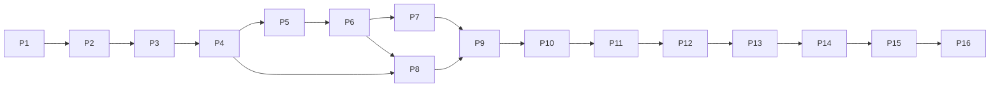

# Roadmap

Incremental phases, each shipping backend **and** frontend for its features.
The **two-player playable prototype** — log in, create/join a game, see the map,
take turns, earn gold, recruit, move battalions, fight, occupy cities — is
reached at the end of **Phase 5**.

**Honest limitation (decision of 2026-10-17):** the Phase 5 prototype has **no
war-ending and no game-ending system**. There is no concede/surrender, no
automatic elimination, and occupation never transfers ownership. Wars end
through peace agreements, which arrive with diplomacy in Phase 9; victory
conditions remain OPEN (Q-T2). Until then the prototype is an open-ended
sandbox, and a running game is closed only by an operator marking it `ABANDONED`.
A **complete game loop (start → war → peace → end)** is therefore a Phase 9
milestone, not a Phase 5 one.

## Reorganisation versus the original list (and why)

The original phase order is kept, with two targeted changes:

1. **Phase 5 includes "simple occupation"** (battalions that hold an enemy city
   province through a round end take **control** of it — never ownership).
   Without it, fighting would have no territorial consequence before sieges.
   Phase 7 replaces simple occupation with real sieges.
2. **Fortress construction moves to Phase 7** (it only matters once sieges exist);
   starting fortresses exist as data from Phase 3.

(An earlier draft also moved concede and elimination victory into Phases 3/5;
both were removed by the 2026-10-17 decisions.)

## Testing strategy (applies to every phase)

| Layer | Tooling | What |
|---|---|---|
| Rules engine | JUnit 5, parameterized + golden tests | Every formula; every worked example in the docs is a test |
| Invariants | jqwik property tests | Population conservation, non-negative gold, determinism, employment priority, monotonic siege progress |
| Application services | Spring Boot tests + **Testcontainers PostgreSQL** | Real transactions, constraints, locking, migrations |
| Concurrency | Testcontainers + `ExecutorService` / `CountDownLatch` | Parallel duplicates, races between commands, exactly-once round processing |
| Web/API | MockMvc (or `RestTestClient`) with a test JWT decoder | Status codes, problem details, auth matrix per endpoint |
| Security matrix | Parameterized API tests | unauthenticated / non-member / non-active / wrong owner for every command |
| Architecture | ArchUnit or Spring Modulith verify | Module boundaries, `rules` has no Spring/JPA imports |
| Scenario | Test DSL (`ScenarioBuilder.game().nation("A").city("Varn", 12_000).workshops(T1,3)…`) | Multi-round economic and military scenarios end-to-end through the command pipeline |
| Replay determinism | Re-run recorded `game_command` streams on a fresh game | Identical final state hash |
| Frontend | Vitest + React Testing Library | Components with logic (forms, map interactions) |
| E2E | Playwright (from Phase 5), two browser contexts | Two players play several turns |

Mockito is used for collaborators at module boundaries (e.g. email provider), not
to mock repositories in place of real database tests.

---

## Phase 0 — Specification and architecture *(this package)*

- **Scope:** documentation only.
- **Deliverables:** README, AGENTS.md, all `docs/` files.
- **Acceptance:** documents internally consistent; every rule labelled; open
  questions prioritised; P0 questions answered or accepted before Phase 1 work
  that depends on them.
- **Non-goals:** any code, project scaffolding, dependency installation.

## Phase 1 — Backend foundation

- **Scope:** runnable backend with full engineering scaffolding; no game logic.
  Backend-only by decision of 2026-10-17.
- **Backend:** Maven project generated with Spring Initializr (Java 21, Spring
  Boot 4.1.x, Web MVC, Security, Data JPA, PostgreSQL, Flyway, Validation,
  Actuator); `local`/`prod` profiles with environment-variable configuration;
  `GET /api/v1/health`; centralised RFC 9457 error handling (`ApiProblem`,
  stable `code`, `requestId`); request-id filter + MDC; default-deny security
  policy (only health endpoints public; everything else 401; no login).
- **Frontend:** none. The Vite + React + TS scaffold moves to the start of Phase 2.
- **Database:** Flyway `V1__baseline.sql` creating schema `game` and a
  `schema_info` row used to verify migrations; no gameplay tables.
- **Infra:** `docker-compose.yml` (PostgreSQL 17), `.env.example`, backend
  Dockerfile (multi-stage, non-root), GitHub Actions CI (`./mvnw verify` on Java 21).
- **Tests:** context starts against Testcontainers PostgreSQL; JDBC connectivity;
  Flyway applied (history + baseline row); health endpoint JSON; security policy
  (health public, unknown API paths 401, actuator internals not exposed);
  error-handler format.
- **Acceptance:** `docker compose up -d` + `./mvnw spring-boot:run` works from a
  clean clone following README; CI green.
- **Non-goals:** auth flows, game tables, value types for gold/population (Phase 4),
  module boundary tests (added with the first real module in Phase 2), deployment.

## Phase 2 — Authentication, players, lobby, frontend scaffold *(implemented 2026-10-17)*

- **Scope:** real users sign up, sign in and gather in private two-player lobbies.
- **Backend (done):** OAuth2 resource server with the Supabase JWKS decoder (signature,
  issuer, expiry, audience, role, UUID subject, non-anonymous; asymmetric algorithms only);
  CORS for the Vite origin; `GET/PATCH /api/v1/me` with race-free first-login provisioning;
  `identity` and `lobby` modules; `POST /games`, `GET /games`, `GET /games/{id}`
  (members only, 404 otherwise), `POST /games/join` (invite code, row lock, idempotent for
  existing members, 409 when full); dependency-free module-boundary test.
- **Frontend (done):** Vite + React + TypeScript (strict) + React Router + TanStack Query;
  Supabase JS client for auth only; login, register (with email-confirmation handling),
  session restore, protected routes, dashboard (profile, my games, create, join, log out),
  lobby page (participants, open slots, invite code with copy, status, 3 s polling while
  waiting); central API client; dark theme; Vitest + Testing Library; CI job.
- **Database (done):** `V2__players_and_lobbies.sql` — `player`, `game`, `game_player` with
  uniqueness, capacity, status and invite-code constraints; RLS enabled (deny-all).
- **Tests (done):** JWT validation matrix (13 rejected token kinds), security slice tests,
  lobby domain/service unit tests, PostgreSQL integration tests including concurrent joins
  for the last slot and concurrent first logins, frontend component/flow tests.
- **Acceptance:** two accounts can register, sign in, create a lobby, join it by code and
  both see it READY; unauthorized access is rejected with documented codes. *Verified with
  signed test tokens against real PostgreSQL; a run against a real Supabase project is still
  outstanding (needs project credentials).*
- **Moved to Phase 3 (deliberately not built):** nation selection, game start, leaving or
  cancelling a lobby, public lobby listing, `map_template`/`nation_template` seed.
- **Deviations from the original plan:** provisioning happens on `GET /me` (no separate
  `POST /me`); "my games" is `GET /games` (no `/me/games`); frontend API types are
  hand-written until an OpenAPI document exists (adding springdoc needs approval).
- **Non-goals:** map, turns, any gameplay; email; social login; WebSockets; deployment.

## Phase 3 — Nations, map, game start, sequential turns *(implemented 2026-10-17)*

- **Scope:** a started game shows its own fictional map and players take turns.
- **Backend (done):** `world` module — map templates read from PostgreSQL into immutable
  topology records plus separate SVG geometry; `MapValidator` run at start-up; seed map
  *The Sundered Reach* (12 provinces, 2 nations, rivers on the border, mountains); per-game
  world instantiation (nations, provinces with separate owner/controller, cities).
  `game` module (the Phase 2 `lobby` package, renamed) — nation choice under the game lock,
  host-only transactional and repeat-safe start, sequential turns with `expectedTurnNumber`,
  Idempotency-Key replay via `game_command`, exactly-once round completion via the
  `round_resolution` guard, and `RoundProcessor` with an explicit (still empty) phase list as
  the extension point for Phase 4+. `GET /maps/{id}`, `GET /games/{id}/state` (ETag),
  `PUT …/players/me/nation`, `POST …/start`, `POST …/turn/end`.
- **Frontend (done):** nation picker and host Start button in the lobby (polls until the
  start); game screen with an interactive, keyboard-accessible SVG map coloured by real
  ownership (occupation hatching ready), rivers, mountains and capitals; province panel (terrain,
  owner, controller, city, population, neighbours, placeholders for economy/armies); round and
  active-player bar, End Turn, waiting indicator; 3 s polling.
- **Database (done):** `V3__world_templates`, `V4__seed_sundered_reach_map`,
  `V5__game_start_and_turns`.
- **Tests (done):** map validation (unit + seeded map in PostgreSQL), adjacency symmetry,
  independent worlds per game, cross-game FK rejection, nation choice permissions and races,
  unauthorized/duplicate/concurrent starts, host-first order, inactive-player rejection,
  stale turns, idempotent and concurrent end turns, round increments exactly once, rollback of
  a failed world initialization and of a failed round end, cross-game authorization; frontend
  lobby and game-screen flows.
- **Decided:** Q-W2 (occupied cities yield no income — enforced from Phase 4).
- **Deferred:** operator "mark abandoned" endpoint (needs an operator role; Phase 11),
  `game_event` history feed, map pan/zoom (the map scales to its container), OpenAPI-generated
  frontend types.
- **Non-goals (kept):** economy, recruitment, movement, combat, sieges, tech, diplomacy,
  concede/elimination/victory, turn timers, WebSockets, deployment.

## Phase 4 — Population, employment, economy, workshops *(implemented 2026-10-18)*

- **Scope:** cities produce gold; players build Tier 1 workshops.
- **Backend (done):** `economy` module — pure rules (employment by tier priority, exact milligold
  income, occupied cities collect nothing (Q-W2), settlement with arrears (Q-E1/Q-E1b),
  construction checks and Q-E8 timing); ruleset file `rulesets/v1/economy.json` selected by
  `game.ruleset_version`; treasuries, workshops and projects; round-end phases `ECONOMY` and
  `CONSTRUCTION` plugged into the Phase 3 round processor; starting treasury and capital workshop
  at game start. `game.api` extension points (`RoundPhase.Step`, `GameCommands`, `GameAccess`,
  `GameStartInitializer`). Endpoints `GET …/economy`, `GET …/cities/{id}/economy`,
  `POST …/cities/{id}/workshops`.
- **Frontend (done):** treasury card (gold, projected income, upkeep, net, last round, arrears),
  city economy in the province panel (farmers, Tier 1/2 workers, production vs collected,
  occupation explanation, workshops with status and completion round), Tier 1 construction with
  server-provided price, timing, enable state and reasons; refresh on every state version change.
- **Database (done):** `V6__economy` incl. backfill of games started before Phase 4.
- **Tests (done):** golden tests for the worked examples, exact milligold, priority, damaged and
  unfinished workshops, occupation and liberation, settlement and arrears, construction rules and
  timing, determinism; PostgreSQL tests for authorized/unauthorized/inactive/occupied/unaffordable
  construction, concurrent orders (treasury and city limit), idempotent replays, independent games,
  round-end income once (incl. retries), completion at the intended round, full rollback, and the
  V6 migration of a running Phase 3 game; frontend economy tests.
- **Deferred (not Phase 4):** upkeep sources (battalions Phase 5, fortresses Phase 7 — upkeep is 0
  until they exist), Tier 2 unlock and upgrades (Phase 8), repairs (Phase 7), growth (Q-E6).
- **Non-goals (kept):** recruitment, movement, combat, sieges, technology, diplomacy, WebSockets.

## Phase 5 — Recruitment, armies, movement, basic battles → **VERTICAL SLICE** *(implemented 2026-10-18)*

**As implemented** (scope set by the Phase 5 request of 2026-10-18, which differs from the plan
below in three places: basic frontline protection and a provisional cavalry flank are **in**;
disband and reinforcement are **out**; the Playwright two-player session is **not yet written**):

- **Backend (done):** `military` module — pure rules (`Battle` = COMBAT_AND_SIEGE §2 incl.
  protection, exposure, flank, terrain; `Recruitment`, `Movement`, `Upkeep`, `Retreat`,
  `Occupation`); ruleset files `rulesets/v1|v2/military.json` (v2 = new games, with starting
  forces 3I 1C raised from the capital); recruit, move (with immediate battle, retreat or
  destruction) and regroup through `GameCommands`; battle reports as JSONB; battalion upkeep via
  `economy.api.UpkeepSource`; simple occupation at round step `SIEGES`. Migration `V7__military`.
- **Frontend (done):** province forces panel (battalions with type, strength bar, owner, army,
  eligibility; multi-select), move controls (adjacent destinations marked friendly / enemy
  territory / attack with hostile count, river penalty, reasons when disabled), army grouping,
  recruitment (type, cost, civilians taken, population after, upkeep, server blockers), battle
  report panel, "Your forces" card (upkeep, recent battles), map unit markers and move-target
  highlights, occupied hatching from Phase 3.
- **Tests (done):** golden battle tests for every §3 example, invariant grid, rule tests;
  PostgreSQL ITs for recruitment, movement, regrouping, battles, retreat, destruction,
  occupation, upkeep, races, idempotency, rollback, isolation, V7 on a running game;
  frontend component tests.

**Original plan:**

- **Scope:** the first playable two-player prototype (open-ended; no war end).
- **Plugs into:** recruitment reduces `city.population` (the economy recalculates from it with
  no other change), its cost goes through `GameCommands` and the treasury; battalion upkeep goes
  into the marked point of the `ECONOMY` round phase.
- **Backend:** recruit (population and gold deducted, recruited-turn readiness);
  armies as organisational groups (create, rename, regroup — never resetting
  eligibility); **battalion-level movement** (select eligible co-located
  battalions, adjacency, one step per battalion per player turn); disband with
  origin/fallback rule; upkeep phase + deficit rule; **basic battle** (the PROPOSED
  model of COMBAT_AND_SIEGE §2 with protection fixed at P = 1 and flanking
  disabled: unit attack/defence, cavalry terrain factor, river and mountain
  penalties, 3 phases, partial casualties, break/winner/retreat), with all
  battalions present defending (including new recruits); battle reports;
  **simple occupation** (control only) at round end.
- **Frontend:** recruitment dialog (shows population and income impact),
  battalion/army markers on the map, army panel with per-battalion "can move"
  state, multi-select battalions and click-to-adjacent move with highlights,
  regroup UI, occupied-province styling (owner colour + controller hatching),
  battle report modal.
- **Database:** `army`, `battalion` (with `recruited_turn_number`,
  `last_moved_turn_number`), `battle_report`.
- **Tests:** recruit/disband population conservation; disband fallback when the
  origin city is occupied; per-battalion eligibility (moving A leaves B eligible;
  regrouping never resets; new recruits cannot move but do defend); battle golden
  tests; occupation changes controller and never owner; Playwright two-player
  session over several rounds with a battle and an occupation.
- **Acceptance:** two people can play from lobby through many rounds in the
  browser with economy, recruitment, movement, battles and occupation; all actions
  validated server-side; no state corruption under concurrent tabs. **Not**
  required: an end of war or an end of game.
- **Non-goals:** concede/surrender, elimination, victory, sieges, reinforcement,
  flanking/protection, tech, diplomacy.
- **Decided inputs:** Q-M1, Q-M2, Q-M3, Q-M5, Q-E1b, Q-C2, Q-C3 (2026-10-17).
- **Q-W2 decided (2026-10-17):** occupied cities yield no income to either side.

## Phase 6 — Advanced combat, reinforcement and disbanding *(implemented 2026-10-19)*

**As implemented** (the full combat model already shipped in Phase 5, so Phase 6 reviewed it
rather than rewriting it):

- **Combat review:** 24 deterministic balance scenarios ([BALANCE_ANALYSIS.md](BALANCE_ANALYSIS.md))
  as golden tests; no numerical defect, coefficients and rulesets unchanged (Q-C1 still
  PROVISIONAL); fixed the report when both sides break in the same phase; richer battle report
  (per-type start → end, plain-language effects: terrain, flank, screen collapse, breaking).
- **Reinforcement (Q-R1 option A):** `POST …/battalions/{id}/reinforcements {soldiers}` — local
  owned-and-controlled city, ≤ 500 per battalion per turn, recruitment cost pro rata, real
  civilians, not in arrears; a reinforced battalion cannot move or attack that turn (PROVISIONAL)
  but defends. `reinforcementPerTurn` added to the rulesets.
- **Origin cohorts:** `battalion_cohort` keeps soldiers per origin city; battle losses are
  apportioned over cohorts; existing battalions backfilled with one cohort (V8).
- **Disbanding:** `POST …/battalions/{id}/disband` — own-controlled territory, survivors return per
  cohort to their origin city or, if it is lost, to the local city; upkeep stops.
- **Battalion detail:** `GET …/battalions/{id}` (cohorts, reinforcement quote, disband preview).
- **Frontend:** reinforcement controls (missing, available, cost, civilians, reasons), disband with
  confirmation (returns per city, fallback, upkeep saved), enhanced battle report.
- **Tests:** rule tests (reinforcement, cohorts, disband, eligibility, scenarios, both-broke);
  PostgreSQL ITs (authorization, hostile territory, population/gold/arrears, races, retries,
  disband returns and fallback, conservation of people through recruit → reinforce → battle →
  disband, rollback, isolation, V8 backfill); frontend tests.
- **Not done:** the server-side "battle odds" preview (still OPEN whether predictions should be
  shown); a Playwright session (needs a Supabase test project; no auth bypass was added).

**Original plan:**

- **Scope:** composition matters.
- **Backend:** full PROPOSED combat model: 3 phases, protection ratio, artillery
  effectiveness/exposure, cavalry terrain and flanking, break threshold; battalion
  apportionment of losses; reinforcement command (chosen option from Q-R1);
  coefficients from ruleset.
- **Frontend:** detailed battle report (per-phase table, why you won/lost:
  protection, flank, terrain), pre-move "battle odds" hint (OPEN: server-side
  preview endpoint — decide whether showing predicted results is desired),
  reinforce action.
- **Tests:** all COMBAT_AND_SIEGE.md examples as golden tests; properties (more
  troops never worse; zero artillery ⇒ P = 1; losses ≤ manpower).
- **Acceptance:** documented examples reproduced exactly; balance knobs editable
  without code change.
- **Non-goals:** frontage, morale as a separate resource, pursuit.
- **Blocking decisions:** Q-C1 (accept model), Q-R1 (reinforcement), Q-C5 (multi-army).

## Phase 7 — Sieges, attrition, damage, repairs, fortresses *(implemented 2026-10-19)*

**As implemented:**

- **Backend:** new `siege` module (pure `siege.rules`, ruleset `rulesets/v3/siege.json`, migration
  `V9`); one control phase at round step `SIEGES` replaces the Phase 5 occupation phase (unfortified
  → simple occupation, fortified → siege); sieges start and lift on moves via `military.api.SiegeGate`
  and advance only at round ends (attrition 5% floored, progress points with artillery by manpower,
  fall with artillery damage to the fortress and one workshop, control only); fortress build, upgrade
  and repair commands and round step `FORTIFICATIONS`; workshop repairs in the economy module; fortress
  upkeep; besieged-city restrictions on recruit, reinforce, build, repair and disband (Q-S11).
  New games use ruleset v3 with six starting fortresses; running games keep v1/v2 unchanged.
- **Frontend:** fortress and siege markers on the map, a fortification section in the province
  panel (level, integrity, project, siege progress bar, rate, artillery explanation, estimated rounds,
  civilian losses, why the city is not yet taken), fortress build/upgrade/repair and workshop repair
  with costs, timing and reasons, a Sieges card with active sieges and results.
- **Tests:** golden tests for the design's duration and attrition tables, rule tests for control
  decisions, fortress works and repairs; PostgreSQL ITs for complete sieges with and without
  artillery, field combat first, withdrawal, relief, besieged-city restrictions, fortress works,
  races, retried round ends, rollback, isolation and the V9 migration; frontend tests.
- **Not done:** pre-attack siege duration preview, garrisons (Q-S9), multi-nation sieges (Q-S10),
  partial bombardment damage (Q-S13), a Playwright session.

**Original plan:**

- **Backend:** siege lifecycle (start, participants, withdrawal, relief, lift);
  round phase with attrition and progress; fall: control transfer (owner unchanged),
  artillery damage; repair command; fortress construction and upkeep; recruitment
  blocked in besieged cities.
- **Frontend:** siege indicators on map, siege panel (progress x/y, rounds
  remaining estimate, population lost so far, artillery vs starvation outcome
  preview), repair actions, damaged-building badges.
- **Database:** `siege`, `siege_participant`.
- **Tests:** siege tables in COMBAT_AND_SIEGE.md as golden tests; withdrawal and
  relief scenarios; capture while UNDER_REPAIR; attrition rounding.
- **Acceptance:** both siege strategies produce the documented trade-off.
- **Non-goals:** garrisons, multi-nation sieges (needs alliances).
- **Blocking decisions:** Q-S1 … Q-S9.

## Phase 8 — Technology, doctrine, institutions *(implemented 2026-10-19)*

**As implemented:**

- **Backend:** new `research` module (pure `research.rules`, ruleset `rulesets/v4/research.json`,
  migration `V10`): Military Academy / University / Barracks (one per type per city), three national
  point pools paid once per round end, military and civilian technology levels 1–3, four tier-1
  doctrines (one may be chosen); effects flow through `military.api.MilitaryModifiers` into the battle
  engine (damage, terrain penalties), the siege engine (artillery progress) and battalion upkeep, and
  through `economy.api.EconomyTechnology` into Tier 2 upgrades and growth. Economy: Tier 1 → 2 workshop
  upgrade command, population growth round phase. New games use v4; v1–v3 games are unchanged.
- **Frontend:** research card (pools, tracks, doctrines, institutions, effects in force), institutions
  in the province panel, Tier 2 upgrade with projected production, growth line in the city economy.
- **Tests:** rule tests (research, modifiers in battles and upkeep, siege bonus, growth, upgrades,
  Tier 2 employment); PostgreSQL ITs (institutions, research income once per round, unlocks,
  doctrines in real battles, sieges and upkeep, Tier 2 upgrade and output, bombardment of an
  upgrading workshop, growth incl. siege and occupation, rollback, isolation, v3 compatibility, V10
  migration); frontend tests.
- **Not done:** institution upgrades or tiers, doctrine respec, research in occupied cities, a
  Playwright session.

**Original plan:**

- **Backend:** institution buildings; research tracks and points phase; typed
  modifiers fed into economy/combat/siege rules; Tier 2 unlock via civilian tech;
  doctrine terrain-penalty reduction and break-threshold bonus.
- **Frontend:** technology screen (three tracks, progress, effects), institution
  construction.
- **Database:** `nation_research`; ruleset tech section.
- **Tests:** modifier application in each rule; unlock gating; research accumulation.
- **Non-goals:** large branching tree, eras art.
- **Blocking decisions:** Q-X1 (costs, effects, tree shape), Q-C7.

## Phase 9 — Diplomacy, wars, peace *(implemented 2026-10-19)*

**As implemented** (rules in [DIPLOMACY.md](DIPLOMACY.md)):

- **Backend:** new `diplomacy` module (pure `diplomacy.rules`, ruleset `rulesets/v5/diplomacy.json`,
  migration `V11`): peace by default, war declarations, normal alliances and defensive pacts with
  mutual acceptance, expiry and termination rules, the defensive response (defender's allies join),
  server-side war score from recorded battles and sieges plus current occupation, peace proposals
  (propose, accept, reject, counter, cancel, expire) settled atomically with province cessions,
  reparations, ten-round tribute and population transfers, truce, return of occupied provinces,
  deterministic withdrawal of battalions without access, round-30 match completion with stored
  results. War now gates movement, battles, occupation and sieges through
  `military.api.Hostility`; new games use v5, v1–v4 games keep permanent war and never finish.
- **Frontend:** diplomacy card (relations with blockers and access, wars with score breakdown and
  duration, alliances, proposals inbox, treaties, tribute, history), peace negotiation with all four
  term types, gains/losses summary, server check and confirmation of major settlements, war-aware
  movement (closed neutral territory), game-completion screen with read-only final map.
- **Tests:** pure rule tests (relations for five nations, defensive response, war score incl. worked
  example and bounds, every term violation, tribute rounding, victory ranking and draws, ruleset
  files), module-cycle and rules-purity checks; PostgreSQL ITs (peace by default, war gating,
  concurrent and repeated declarations, alliances and access, expiry, atomic settlement, revalidation,
  concurrent acceptance, tribute for exactly ten rounds with shortfall, renewed war, privacy and
  authentication, rollback of settlement/tribute/result, round-30 finish, read-only finished games,
  v3 compatibility, V11 migration) and one complete 30-round game through the API; frontend tests.
- **Not done (Phase 10 or later):** coalition battles, terms involving non-leaders, offensive calls to
  arms, war-score costs of terms, separate peace, a Playwright session.

**Original plan:**

- **Backend:** relations (pacts/alliances), war declaration, calls to arms,
  war score calculation, peace offers with the four
  term types (annexation is the only path that changes legal ownership), tribute
  round phase, population transfer; war-ending through peace; victory conditions
  once Q-T2 is decided → first complete game loop.
- **Frontend:** diplomacy screen, war overview with war score, peace offer builder,
  incoming proposal inbox (answered on your turn).
- **Database:** diplomacy tables (DATA_MODEL §3.7).
- **Tests:** peace term application atomicity; tribute for exactly 10 rounds;
  population transfer conservation; alliance call rules.
- **Non-goals:** AI nations, coalitions beyond two sides, trade.
- **Blocking decisions:** Q-D1 … Q-D5, Q-T2 (victory), Q-T3 (stalled games).

## After Phase 9 — agreed order (decided 2026-10-19)

There is **no separate gameplay-testing phase**: the product owner plays the complete game
manually after Phase 9, when the full loop (economy → war → peace → end) exists; the main
balancing pass follows from that playtest. Until then gameplay is verified by automated tests.
**Security fundamentals are applied in every phase** (authentication and membership checks on every
endpoint, server-authoritative commands, no secrets in code, validated input); Phase 15 audits and
hardens, it does not introduce security for the first time.

## Phase 10 — World Expansion, N-Faction Multiplayer & Coalition Diplomacy — **implemented (2026-10-20)**

**10A — world and multiplayer:**

- **Map:** Grand Campaign (72 irregular provinces, 10 fictional Europe-inspired factions, rivers,
  mountains), generated deterministically by `tools/mapgen/grand-campaign.mjs` from original data;
  adjacency = shared land border ≥ 16 units (corner touches excluded), validated against the geometry
  at startup; city points separate from outlines. The Sundered Reach stays available.
- **Nations and lobbies:** 2–4 human players, map choice and player count at creation, only playable
  factions selectable, no duplicates, invitation codes as before; every other faction is a passive
  NPC placeholder (not an AI). Turns skip nations without a player and eliminated players.
- **Balance:** starting treasury, capital workshops and forces per faction tier and fortresses per
  map, all in ruleset v6.
- **Gold gifts:** active player, positive bounded milligold, atomic, idempotent, public history,
  blocked to war enemies (configurable); Send Gold card with preview and confirmation.
- **Map UI:** pan, zoom (buttons and wheel), drag, selection, city markers.

**10B — coalitions:**

- Coalition battles (per-nation modifiers, per-battalion losses, cohorts preserved, per-nation
  report lines, no merged nation); allies defend together; coalition occupation and sieges.
- Attached battalions (owner lends to an ally or co-belligerent, commander moves and attacks only,
  owner pays and recalls, invalid attachments end); movement once per global round in v6.
- Defensive calls to arms (honour joins, decline ends the alliance; no deadline or penalty).
- War leaders (declarer and target; succession on elimination).
- Peace conferences: request and answer out of turn, whole-game pause, immutable revisions,
  approvals bound to revisions, required approvals of both principals and every giver, atomic
  re-validated settlement, cancellation, no timeouts or automatic acceptance.
- Separate peace for non-leaders; elimination of landless nations; domination victory; v6 score
  with gold; results stored once; no concede button.
- **Frontend:** call-to-arms card, conference card (revision, terms, approvals, approve/reject,
  revise, end), general and separate peace buttons, pause banner, lend/recall battalions, coalition
  battle report, eliminated markers, domination results.
- **Tests:** pure rule tests (geometry, coalition damage, round movement, coalition control, peace
  sides, approvers, NPC placeholder, v6 victory), PostgreSQL ITs (Grand Campaign lobby, turns, NPCs,
  gifts; calls, attachments, coalition and allied battles; conferences, pause, revisions, approvals,
  rollback, concurrency, separate peace, NPC counterpart, elimination, domination, access control;
  v5 compatibility) and a four-human, ten-nation end-to-end scenario; frontend tests.
- **Not done:** AI (Phase 11), offensive calls to arms, neutral land (Q-W4), war-score costs of terms,
  a Playwright session, balancing of the new map (Q-W5).

## Phase 11 — Enemy AI

- Computer-controlled nations that take their sequential turn through the same command pipeline
  as players (no special access to state).

## Phase 12 — Accounts & Player Profiles

- Profile pages, statistics and history, account settings and deletion; the analytics and
  email ideas of [BACKGROUND_JOBS.md](BACKGROUND_JOBS.md) are revisited here (unscheduled until
  then).

## Phase 13 — Public/Private Games & Friends

- Public lobby discovery alongside private invitation codes; friends list and invitations.

## Phase 14 — UI/UX Overhaul

- Complete visual and interaction redesign, onboarding and tutorial (the current UI keeps the
  functional dark theme until then).

## Phase 15 — Security Audit & Hardening

- Full security review; API abuse prevention, rate limiting, request and resource limits, cloud
  cost-abuse protection; security headers; Supabase production hardening (schema not exposed,
  RLS deny-all, least-privilege roles); dependency and secret scanning.

## Phase 16 — Cloud Deployment & Public Beta

- Production deployment pipeline (e.g. VPS + Caddy + GHCR), backups and restore drill,
  metrics, alerts and error tracking, load test, public beta.

## Dependencies

## MVP boundaries

| In MVP (end of Phase 5) | Out of MVP |
|---|---|
| Supabase login, lobby, 2–4 players | Turn timers, AI players |
| Fictional SVG map, plains/mountains, rivers | Fog of war |
| Sequential turns (fixed order, no deadlines) | Concede/surrender, elimination, victory (Q-T2), diplomacy, peace |
| Population, employment, Tier 1 workshops, income, upkeep | Tier 2 (tech-gated), growth |
| Recruit, battalion-level move, army regrouping | Reinforcement and disbanding (done in Phase 6) |
| Deterministic battle with terrain, protection and flanking (provisional coefficients) | Final balance (after Phase 9) |
| Simple occupation (control only; owner unchanged) | Sieges, attrition, damage (Phase 7); annexation (Phase 9) |
| Battle/round reports | Analytics, email |
