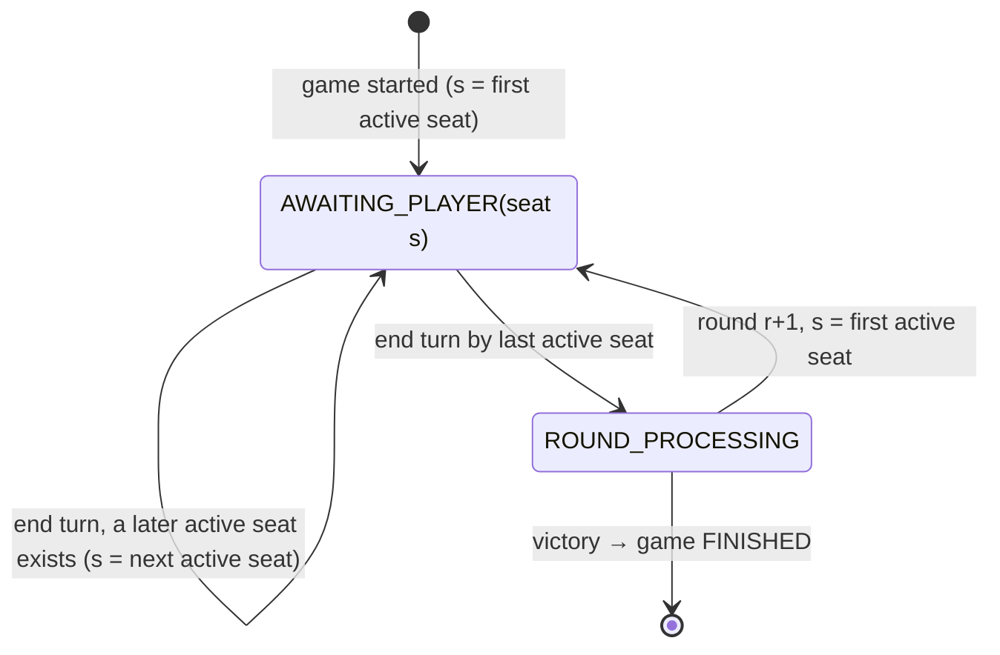

# Turn System

Sequential turns, active-player enforcement, immediate actions, global round
processing, and the transaction / concurrency / idempotency strategy.

## 1. Approved requirements

- Classic **sequential** turns; no simultaneous order resolution.
- The active player acts; valid actions apply immediately; the player explicitly
  ends their turn; the next player sees the changes.
- When every player has ended their turn, the **global round** ends and recurring
  calculations run (income, upkeep, research, siege progression, population, …).
- No deadlines, no scheduled automatic advancement in the MVP.
- Only the active player may issue gameplay commands. The server validates all
  commands. Invalid actions never partially modify state. Concurrent requests
  must not corrupt state. End turn must not execute twice. Round processing is
  transactional and idempotent. Failures roll back safely.

## 1a. Implementation status (Phase 3)

Implemented exactly as designed below, with these notes:

- **Lifecycle:** `WAITING_FOR_PLAYERS → READY → IN_PROGRESS`. Start = host only, READY, every
  player on a distinct nation and every map nation played; one transaction under the game row
  lock (world instantiation + status change); repeating it returns the started game.
- **Turn order:** fixed seat order, seat 0 (the host) first; pure rule `game.rules.TurnOrder`.
- **End turn** (`TurnService`): lock → membership (404) → idempotency → `IN_PROGRESS` →
  active player (`NOT_ACTIVE_PLAYER`) → `expectedTurnNumber` (`TURN_CHANGED`) → advance →
  record `game_command`.
- **Idempotent replay** returns the game's *current* turn state with `replayed: true` instead
  of a stored copy of the original response. The guarantee that matters — a retried request
  never acts twice — holds; storing response bodies can be added if clients need them.
- **Round end:** `RoundProcessor.completeRound` inserts the `round_resolution` guard row, then
  runs the phases in `RoundPhase.Step` order (the enum in `game.api` is the single definition of
  the order; at most one phase per step). Phase 4 implements `ECONOMY` (income → upkeep →
  settlement, every nation in one transaction) and `CONSTRUCTION` (project completion after
  income). A failure in any phase rolls back the whole end of turn — no nation is ever paid alone.
- **Commands of other modules** (Phase 4: workshop construction) use `game.api.GameCommands`:
  the same lock → membership → idempotency → in progress → active player pipeline, recording the
  command with a `result_ref` so a retried request returns the original result.
- **Game start** runs `game.api.GameStartInitializer`s after world instantiation (Phase 4: the
  economy creates treasuries and starting workshops; Phase 5: ruleset v2 starting battalions
  raised from each capital's population), inside the start transaction.
- **Phase 6 commands** `REINFORCE` and `DISBAND` use `GameCommands`; their `result_ref` is a
  `manpower_transfer` row holding the original response, so retries replay it exactly. A battalion
  reinforced in the current turn has eligibility `REINFORCED_THIS_TURN` (column
  `last_reinforced_turn_number`, same equality check as §9a) — it defends but cannot move or attack.
- **Phase 5 commands** `RECRUIT`, `MOVE` (including the immediate battle) and `REGROUP` use
  `GameCommands`; `result_ref` is the battalion, the battle report (or the first moved
  battalion when no battle was fought) and the army. Movement eligibility (§9a) uses
  `game.turn_number`, now also exposed to other modules through `GameAccess.Membership`.
- **Round step `SIEGES` (Phase 5, extended in Phase 7):** one control phase in the siege module,
  before `ECONOMY`, for every province in key order — simple occupation of unfortified provinces
  (Q-M2) and, for fortified ones, sieges: start, lift, attrition, progress, fall, bombardment
  (COMBAT_AND_SIEGE §5.0). Ownership never changes. Moves also start and lift sieges mid-turn
  through `military.api.SiegeGate`; only round ends advance them, at most once per siege per round.
- **Phase 8 round steps:** `RESEARCH` (after `ECONOMY`: points from institutions ACTIVE before this
  round's completions, once per nation per round), `GROWTH` (after research: civilian growth of owned,
  controlled, unbesieged cities), and `INSTITUTIONS` (last: institutions due this round become ACTIVE
  and produce from the next round). Workshop upgrades complete in `CONSTRUCTION`. Full order:
  SIEGES → ECONOMY → RESEARCH → GROWTH → CONSTRUCTION → FORTIFICATIONS → INSTITUTIONS.
- **Round step `FORTIFICATIONS` (Phase 7):** fortress build, upgrade and repair projects due this
  round complete after `CONSTRUCTION` (a project in a besieged city waits).
- **Reads:** `GET /games/{id}/state` runs as one REPEATABLE READ snapshot and returns an ETag
  (state version); the frontend polls it every 3 s and unchanged polls are 304s.
- Not yet implemented: `game_event`, `game_incident`, the operator "abandon" endpoint (needs an
  operator role, Phase 15–16), `lock_timeout`/`GAME_BUSY`.

## 2. Vocabulary

| Term | Meaning | Stored as |
|---|---|---|
| Round | One full cycle of all seats + round processing | `game.current_round` (starts at 1) |
| Seat | A player's position in turn order | `game_player.seat_order` (0..n−1) |
| Turn | One seat's portion of a round | `game.active_seat` |
| Turn number | Global, monotonically increasing count of turns started | `game.turn_number` |
| Game version | Incremented on every committed state change | `game.state_version` |

`turn_number` is the token clients echo back (`expectedTurnNumber`) to prove they
are acting on the turn they think they are. `state_version` drives HTTP ETags
and client refresh.

## 3. State machines

### 3.1 Game lifecycle

```mermaid
stateDiagram-v2
    [*] --> WAITING_FOR_PLAYERS: create game (creator takes seat 0)
    WAITING_FOR_PLAYERS --> WAITING_FOR_PLAYERS: player joins, a slot is still free
    WAITING_FOR_PLAYERS --> READY: player joins the last free slot
    WAITING_FOR_PLAYERS --> CANCELLED: host cancels (Phase 3)
    READY --> IN_PROGRESS: host starts (Phase 3; nations picked)
    IN_PROGRESS --> FINISHED: victory condition met (Phase 9, PROVISIONAL Q-T2: after round 30, ruleset v5)
    IN_PROGRESS --> ABANDONED: operator action (MVP); player-facing option OPEN Q-T3
    FINISHED --> [*]
    CANCELLED --> [*]
    ABANDONED --> [*]
```

Start validation: `min_players ≤ joined ≤ max_players`, every game player has a
distinct nation, the map template is published. Starting instantiates the
per-game world from the template **in the same transaction** (see
[DATA_MODEL.md §4](DATA_MODEL.md)), assigns seat order, sets `current_round = 1`,
`active_seat = 0`, `turn_number = 1`.

Finishing (Phase 9) happens once, inside the end-turn transaction that completes the last round: the
game keeps its round, seat and turn number, its result is stored, and from then on every gameplay
command (including end turn) answers `409 GAME_FINISHED` while all read models stay available.

### 3.2 Turn cycle (inside IN_PROGRESS)



`ROUND_PROCESSING` is **transient**: it happens inside the same database
transaction as the final end-turn command and is never observable as a committed
state (§6). There is therefore no "stuck in processing" state to recover from.

### 3.3 Game player status

| Status | Meaning | Gets turns? |
|---|---|---|
| `JOINED` | In lobby | — |
| `ACTIVE` | Playing | yes |

Leaving a lobby deletes the `game_player` row. There is **no concede, surrender
or automatic elimination** in the MVP (APPROVED 2026-10-17): a nation that
controls no cities keeps its seat and its turns. Additional statuses (e.g. for a
future peace-based exit) will be added when Q-T2/Q-T3 are decided; the seat
advancement function already skips any seat that is not `ACTIVE`, so adding them
needs no change to the turn logic.

## 4. Command pipeline

Every gameplay mutation (including end turn) runs through one application
service, `GameCommandService.execute(gameId, principal, command)`:

```
BEGIN (READ COMMITTED)
 1. SET LOCAL lock_timeout = '5s'
 2. SELECT * FROM game WHERE id = :gameId FOR UPDATE          -- serializes the game
 3. Resolve principal → player → game_player (404 if not a member)
 4. Check game.status = IN_PROGRESS                           -- 409 GAME_NOT_IN_PROGRESS
 5. Idempotency: look up game_command by (game_id, game_player_id, idempotency_key)
      found, same request hash  → return stored response (no re-execution)
      found, different hash     → 422 IDEMPOTENCY_KEY_REUSED
 6. Check game_player.seat_order = game.active_seat           -- 409 NOT_ACTIVE_PLAYER
 7. Check expectedTurnNumber (if supplied; required for END_TURN) -- 409 TURN_CHANGED
 8. Load the state the command needs; build immutable rule inputs
 9. Validate via the rules engine                              -- 422 <DOMAIN_CODE>
10. Apply: mutate JPA entities from the rules engine result
11. (END_TURN only) advance seat, or run RoundProcessor
12. game.state_version += 1; insert game_command (+ result); insert game_event rows
COMMIT  → return response (new state_version, changed resources)
```

Any exception at any step → full rollback. Nothing is partially applied because
there is exactly one transaction and validation completes before mutation.

### 4.1 Why a pessimistic row lock on `game`

- Commands in one game are rare (human speed) but must be strictly serialized:
  two tabs moving the same army, a double-clicked "End turn", a recruit racing an
  end turn.
- One lock per game is simple to reason about, covers *every* per-game table
  without per-row locking, and has no deadlock risk as long as **the game row is
  always the first lock taken** (rule enforced by the pipeline being the only
  write path).
- Different games never contend.
- Optimistic locking alone (`@Version`) would detect conflicts on the rows that
  were touched, but many commands read rows they don't write (e.g. recruitment
  reads the treasury and city, movement reads enemy armies); write-skew is
  possible. The game lock eliminates it.
- `state_version` is still kept for ETags and client staleness detection.

### 4.2 Idempotency

- Every mutating gameplay request must carry an `Idempotency-Key` header (UUID
  generated by the client per user intent, reused on retry).
- `game_command` has `UNIQUE (game_id, game_player_id, idempotency_key)` and
  stores `request_hash` (SHA-256 of canonical command JSON) and the response body.
- Duplicate submissions **serialize on the game lock**; the second one sees the
  first one's committed `game_command` row in step 5 and replays its response.
  The unique constraint is the backstop if any path ever skips the lock.
- If the first attempt rolled back, no `game_command` row exists, so a retry
  executes normally — exactly the desired semantics.
- Retention: `game_command` rows are kept for the game's lifetime (they double as
  the action log for history and analytics).

### 4.3 End turn exactly once

Three independent protections:

1. Game row lock serializes concurrent end-turn requests.
2. `expectedTurnNumber` must equal `game.turn_number`; after the first succeeds
   `turn_number` has advanced, so a second (different-key) request gets
   `409 TURN_CHANGED` instead of ending the *next* player's turn.
3. Idempotency key replay returns the original success to the retrying client.

### 4.4 Read path

- `GET` state endpoints run in a read-only `REPEATABLE READ` transaction so a
  multi-query snapshot is consistent without locks. They never block commands.
- Responses carry `ETag: "<state_version>"`; clients poll with
  `If-None-Match` and get `304` cheaply when nothing changed (§8).

## 5. Global round processing

Executed by `RoundProcessor.process(game)` inside the final end-turn transaction.
Phases run in this explicit, code-defined order (PROPOSED; order of income vs
upkeep is APPROVED: income before upkeep, Q-E1):

| # | Phase | Introduced | Notes |
|---|---|---|---|
| 0 | Guard: `INSERT INTO round_resolution (game_id, round_number, …)` | 3 | PK conflict → abort (already processed) |
| 1 | `SIEGES`: simple occupation of unfortified provinces; sieges started/lifted, attrition, progress, falls (control transfer, damage) | 5 (occupation), 7 (sieges) | Provinces in key order; each siege once per round |
| 2 | Income per nation | 4 | From post-attrition population |
| 3 | Upkeep per nation | 5 | Armies + active fortresses |
| 4 | Settlement & deficit rule | 4 | `treasury += income − upkeep`, floor 0, arrears |
| 4a | `RESEARCH`: institution points per nation | 8 | Institutions ACTIVE before this round's completions; `research_round_report` PK |
| 4b | `GROWTH`: civilian growth | 8 | After income: new people work from the next round; not while besieged or occupied |
| 5 | `TRIBUTE`: treaty tribute | 9 | `floor(gross income × 10%)`, paid from the treasury after settlement (never more than it holds, shortfall forgiven); `tribute_payment` PK (tribute, round) |
| 7 | `CONSTRUCTION`: workshop construction and repair completions | 4, 7 (repairs) | After income: completions earn from next round |
| 7b | `FORTIFICATIONS`: fortress build / upgrade / repair completions | 7 | After income and after sieges: resists from next round end; waits while besieged |
| 7c | `INSTITUTIONS`: research institution completions | 8 | After research: produces from the next round |
| 8 | `DIPLOMACY`: expiry of unanswered alliance and peace proposals | 9 | Last step, after every other change |
| 9 | Victory check (`game.api.VictoryCondition`, not a `RoundPhase`) | 9 | Ruleset v5: after round 30 the game becomes FINISHED instead of advancing and the result is stored in the same transaction (`game_result` PK); no automatic elimination; older rulesets never finish |
| 10 | Advance: `current_round += 1`, `active_seat` = first ACTIVE seat, `turn_number += 1` | 3 | |
| 11 | Write round report (`round_resolution.summary` JSONB) and `game_event`s | 3 | Per-nation deltas for the UI |

Each phase is a class implementing `RoundPhase` with `apply(RoundContext)`. The
processor holds an explicit `List<RoundPhase>` built in one configuration class —
no reliance on bean ordering annotations. Within a phase, entities are processed
in ascending id order.

### 5.1 Idempotency of round processing

- **Structural:** processing only happens inside the end-turn transaction that
  moves past the last seat; that transaction is serialized by the game lock and
  guarded by `expectedTurnNumber`.
- **Guard row:** `round_resolution (game_id, round_number)` primary key. The
  insert is the first statement of processing; a duplicate would violate the PK
  and roll back. This makes "process round r twice" impossible even under a
  future bug or an admin re-trigger.
- **No external side effects inside the transaction** (no email, no HTTP). Any
  post-commit work (e.g. analytics counters, future notifications) is driven from
  committed rows (outbox pattern), so a rollback never leaves a ghost side effect.

### 5.2 Failure and recovery

- If any phase throws, the whole transaction rolls back: the last player's turn is
  still active, the end-turn command is not recorded, the round is not processed.
  The client gets `500 ROUND_PROCESSING_FAILED` (with a correlation id) and may retry.
- A deterministic bug fails deterministically on retry. To make that visible, the
  failure is logged at ERROR with `gameId/round`, counted in a metric, and
  recorded in `game_incident` via a separate `REQUIRES_NEW` transaction.
  Operators fix the bug and redeploy; the player retries; no data repair needed.
- Lock timeouts (`lock_timeout`) → `503 GAME_BUSY` with `Retry-After`.

### 5.3 Size and timing

Round processing is O(cities + armies + sieges) for one game — hundreds of rows.
Target < 300 ms. The game lock is held for that duration; other players of that
game are only reading, so this is invisible to them. If maps grow by orders of
magnitude, processing can be split into a committed `ROUND_PROCESSING` state plus
a worker, but there is no reason to pay that complexity now.

## 6. Determinism

- Rules engine functions are pure: no `Instant.now()`, no `Random`, no I/O.
- Inputs are sorted by id; outputs list changes in sorted order.
- Integer / fixed-point arithmetic only ([ECONOMY.md §1](ECONOMY.md)).
- Each game stores a **ruleset snapshot** (`game.ruleset` JSONB + `ruleset_version`)
  copied at game creation. Balance changes in new releases never alter running
  games. Rule *code* changes that alter outcomes bump `ruleset_version` and keep
  old behaviour reachable if live games depend on it (or are declared breaking).
- Timestamps (`created_at`) come from an injected `Clock`; they never influence rules.

## 7. Disconnects and abandoned games

APPROVED: no automatic timeout rule. Design:

- **Disconnects are not a game concept.** State is server-side; a player who
  closes the browser simply hasn't ended their turn. Reconnecting = reloading state.
- **Visibility of waiting:** the lobby shows each game's active player and
  `last_action_at`, so stalls are visible.
- **No concede or surrender** in the MVP (APPROVED 2026-10-17).
- **Host cancel** for lobbies.
- **Admin action** (operator endpoint) to mark a running game `ABANDONED`. This
  is the only way a running MVP game closes; it is administrative, not a
  gameplay outcome, and records no winner.
- OPEN Q-T3: a player-facing way to handle stalled games (e.g. unanimous vote
  to abandon, or an optional per-lobby turn timer chosen at creation). Nothing is
  implemented until decided.

## 8. Notifying other players

- MVP: clients poll `GET /games/{id}/summary` every 3–5 s with `If-None-Match`
  while the game screen is open (cheap 304s). The UI shows "Waiting for X" and
  refreshes the full state when the version changes.
- Later: Server-Sent Events per game (`/games/{id}/events`), still fed from
  committed `game_event` rows. WebSockets are unnecessary for turn-based play.
- "It's your turn" email/push is an optional later feature driven by the outbox
  ([BACKGROUND_JOBS.md](BACKGROUND_JOBS.md)); it is explicitly not used to advance turns.

## 9. Non-active player actions

Some actions belong to non-active players (accepting an alliance, answering a peace offer).
**Implemented in Phase 9 (PROVISIONAL):** diplomatic proposals are created on the proposer's turn
and **answered on the recipient's own turn**, through the normal command pipeline; this keeps the
rule "only the active player issues gameplay commands" intact. Unanswered proposals expire at the
end of round `created + 3` (DIPLOMACY.md §3.1, §5.1). Lobby actions are
membership commands, not gameplay commands.

Defence is not an action: battalions defend whenever they are attacked,
including on other players' turns and including battalions recruited earlier in
the same round (GAME_DESIGN §7.5).

## 9a. Battalion movement eligibility

Movement eligibility is per battalion (APPROVED). Two columns on `battalion`
make it enforceable regardless of army grouping:

- `recruited_turn_number` — a battalion may not initiate a move or attack while
  `game.turn_number = recruited_turn_number`.
- `last_moved_turn_number` — set to `game.turn_number` when it moves; a battalion
  may not move again while they are equal.

Because `turn_number` increases for every player turn, "once per player turn" is
an equality check, and neither value is touched by regrouping armies.

## 9b. More players, NPC nations, elimination and the conference pause (Phase 10)

- **Seats.** A game has 2–4 human seats; nations without a player have no seat. Turn order is the
  seat order; `TurnOrder.next` skips the seats of **eliminated** players. Nations without a player
  never take a turn, so they can never block the game. A round ends after the last seat that still
  plays.
- **Elimination** (DIPLOMACY §16) marks `game_player.eliminated_round`; every command of an eliminated
  player answers `409 NATION_ELIMINATED`. If the active player was eliminated by the treaty, the turn
  passes to the next seat when play resumes, in the same transaction.
- **Pause for a peace conference.** While `game.paused_conference_id` is set, `POST /turn/end` and
  every normal command answer `409 GAME_PAUSED_FOR_CONFERENCE`; `yourTurn` is false for everybody;
  round, turn number and active seat do not change. Conference commands use
  `GameCommands.executeOutOfTurn`: lock the game row → membership → in progress → idempotent replay →
  not eliminated → handler → record command → state version (no active-player or pause check). Ending
  the conference clears the pause in the same transaction, and the active player continues its turn.
- **Finishing** may now also happen inside a command (domination after a settlement): the command's
  transaction stores the result exactly once and sets the game `FINISHED` (`GameControl.finishIfDecided`).
- **Movement eligibility** in v6 is per global round (COMBAT_AND_SIEGE §3a).

## 9c. Computer seats (Phase 11, ruleset v7)

- Every nation nobody chose holds a seat after the human seats (nation-key order). The turn order
  is all seats; computers play once per round after the humans; the round ends after the last
  seat and is processed once, for every nation alike.
- When the turn passes to a computer seat, the computer plays it automatically after the commit and
  ends it with the normal end-turn command (expected turn number, idempotency key). Humans see
  "<nation> (computer) is playing its turn"; they cannot act for it.
- Each computer action commits together with the turn's action counter (`ai_turn`), so an
  interrupted computer turn resumes from the last committed action after a restart (a periodic
  sweep finds such games). A conference pause stops a computer turn; it resumes when the pause ends.
- Eliminated computer seats are skipped like eliminated humans.

## 9d. Quick Match, invitations and active-match recovery (Phases 13A–13B)

**Quick Match** pairs two humans for a Grand Campaign game (map key `strategy.social.matchmaking.map-key`)
with every other nation played by the computer, using `strategy.ruleset.current-version` — so a
future ruleset is picked up by configuration, and existing games never change ruleset.

- **Queue consistency.** Join, heartbeat (which also looks for an opponent) and cancel each start
  with `pg_advisory_xact_lock(hashtext('matchmaking:QUICK_2P'))`. All queue changes are therefore
  serialized in PostgreSQL — across threads and across backend instances — and the second of two
  simultaneous joins sees the first's committed ticket. Pairing takes the longest-waiting live
  ticket of a non-blocked player, creates and starts the game through `game.api.MatchCreation`
  (the same lobby, nation and start code as a private game) and marks both tickets MATCHED, all in
  one transaction: a ticket is matched at most once, a pair creates exactly one game, a failure rolls
  everything back (no partial game), and a retried join returns the existing search or match.
  Database backstops: one WAITING ticket per player, `(matched_game_id, player_id)` unique.
- **Cancel versus match.** Serialized by the same lock: either the cancel wins (CANCELLED, the other
  player keeps searching) or the match committed first — then cancel does not undo it and returns
  MATCHED with the game, because the opponent is in that game too.
- **Factions** (`game.rules.QuickMatchNations`): playable nations of the tier with the most playable
  nations (Grand Campaign: the four POWERs); pairs whose capitals are ≥ 4 borders apart preferred;
  a random seed picks the pair and who gets which. The player who waited longer takes seat 0.
- **Search heartbeat versus turn timer.** A search must be refreshed (every 10 s by the client); a
  ticket without a heartbeat for 90 s is never matched and becomes EXPIRED, so nobody is paired with
  a closed tab. This concerns the *search only*. Games still have **no turn timer, no deadline and no
  automatic forfeit** (§7): a matched game waits for its players indefinitely.
- **Recovery.** A matched ticket stays "unopened" until the player opens the game; joining again
  meanwhile returns that match instead of a new search (unless its game has finished). The game is
  also always listed under *My active games*.
- **Bounds.** No new search with 5 or more unfinished games (`max-unfinished-games`).

**Lobby invitations** never bypass the lobby rules: acceptance admits through the game module
under the game row lock, and nation choice and the host's start follow as usual.

**Active matches.** Leaving the game screen ends nothing: no forfeit, no lobby deletion, no turn
end. `GET /games` returns every game with map, faction, round and whether it is the player's turn.
The game screen is keyed by game id, so switching games never carries selections or windows over;
every request names its game, and polling subscriptions belong to the screen that is mounted.

## 10. Testing the turn system

| Test | Kind |
|---|---|
| Seat advancement skips non-ACTIVE seats (future statuses) | Unit (pure function `nextSeat`) |
| Non-active player command → 409, no state change | Integration (Testcontainers) |
| 10 parallel end-turn requests, same key → 1 execution, 10 identical responses | Integration, concurrency |
| 2 parallel end-turn requests, different keys → 1 success, 1 `TURN_CHANGED` | Integration, concurrency |
| Recruit racing end-turn → serial outcome, no lost update | Integration, concurrency |
| Inject exception in round phase 3 → nothing changed, retry succeeds after fix | Integration with a test-only failing phase |
| Manual duplicate `round_resolution` insert → PK violation | Integration |
| Same game played twice from same commands → identical final state | Replay determinism test |
